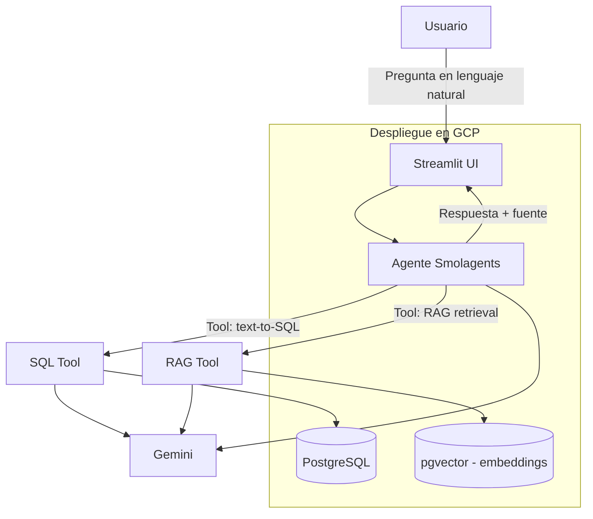

# Especificación Técnica — Pipidu Library Agent

> Documento incremental. Se irá completando/ajustando a medida que avance el diseño e implementación.
>
> **Nivel en el ciclo SDD:** Plan (HOW). Los requisitos verificables del agente y sus tools están en
> `03-especificaciones-por-capacidad.md`; la división en tareas en `04-tareas.md`; la validación en
> `05-validacion.md`.

## 1. Arquitectura general



## 2. Stack tecnológico

| Componente | Tecnología |
|---|---|
| Lenguaje | Python 3.11+ |
| Base de datos | PostgreSQL |
| Vector store | pgvector (extensión sobre el mismo PostgreSQL) |
| LLM | Google Gemini (API) |
| Framework agéntico | Smolagents |
| UI | Streamlit |
| Embeddings | Gemini Embeddings API (`text-embedding-004` o equivalente vigente) |
| Despliegue | GCP (Cloud Run / Compute Engine + Cloud SQL para Postgres) |
| Control de versiones | GitHub |
| ORM / acceso a datos | SQLAlchemy (o psycopg2 directo, a definir en implementación) |

## 3. Modelo de datos relacional (propuesta inicial)

> Sujeto a ajuste fino durante la implementación. Cumple el mínimo de 5 tablas (6 propuestas).

### 3.1 Tablas

**`autores`**
| Columna | Tipo | Notas |
|---|---|---|
| id | SERIAL PK | |
| nombre | VARCHAR(100) | |
| apellido | VARCHAR(100) | |
| nacionalidad | VARCHAR(50) | |
| fecha_nacimiento | DATE | opcional |

**`editoriales`**
| Columna | Tipo | Notas |
|---|---|---|
| id | SERIAL PK | |
| nombre | VARCHAR(100) | |
| pais | VARCHAR(50) | |

**`categorias`**
| Columna | Tipo | Notas |
|---|---|---|
| id | SERIAL PK | |
| nombre | VARCHAR(80) | ej. "Ciencias de la Computación", "Literatura" |
| descripcion | TEXT | |

**`libros`**
| Columna | Tipo | Notas |
|---|---|---|
| id | SERIAL PK | |
| titulo | VARCHAR(200) | |
| isbn | VARCHAR(20) | único |
| autor_id | FK → autores.id | |
| editorial_id | FK → editoriales.id | |
| categoria_id | FK → categorias.id | |
| anio_publicacion | INT | |
| ejemplares_totales | INT | |
| ejemplares_disponibles | INT | |

**`socios`**
| Columna | Tipo | Notas |
|---|---|---|
| id | SERIAL PK | |
| nombre | VARCHAR(100) | |
| apellido | VARCHAR(100) | |
| legajo | VARCHAR(20) | único, para alumnos |
| tipo_socio | VARCHAR(20) | 'alumno' / 'docente' |
| email | VARCHAR(100) | |
| fecha_alta | DATE | |

**`prestamos`**
| Columna | Tipo | Notas |
|---|---|---|
| id | SERIAL PK | |
| libro_id | FK → libros.id | |
| socio_id | FK → socios.id | |
| fecha_prestamo | DATE | |
| fecha_devolucion_prevista | DATE | |
| fecha_devolucion_real | DATE | NULL si aún no devuelto |
| estado | VARCHAR(20) | 'activo' / 'devuelto' / 'vencido' |

### 3.2 Relaciones

- `libros.autor_id` → `autores.id` (N:1)
- `libros.editorial_id` → `editoriales.id` (N:1)
- `libros.categoria_id` → `categorias.id` (N:1)
- `prestamos.libro_id` → `libros.id` (N:1)
- `prestamos.socio_id` → `socios.id` (N:1)

### 3.3 Datos sintéticos

- Generación programática (ej. con `Faker` para nombres/fechas + reglas de negocio simples para consistencia de disponibilidad de ejemplares).
- Volumen objetivo: **15-20 registros por tabla** (mínimo exigido: 15).
- Script de seed versionado en el repo (`scripts/seed_data.py` o similar).

## 4. Repositorio documental para RAG

| Documento | Tipo de contenido |
|---|---|
| `reglamento_biblioteca.pdf` | Normas de préstamo, sanciones, plazos, horarios |
| `manual_uso_sistema.pdf` | Instrucciones de uso de la plataforma de biblioteca |
| `politicas_universidad.pdf` | Políticas institucionales generales |
| `resenas_libro_1.pdf` … `resenas_libro_3.pdf` | Sinopsis/reseñas de 1 a 3 libros del catálogo |

Total: entre 4 y 6 PDFs (mínimo exigido: 2).

### 4.1 Pipeline de ingesta RAG

1. Extracción de texto de los PDFs (`pypdf` / `pdfplumber`).
2. Chunking (ej. 500-1000 tokens con overlap).
3. Generación de embeddings (Gemini Embeddings API).
4. Almacenamiento en `pgvector` (tabla `documentos_embeddings` con columna `vector`).
5. Retrieval por similitud coseno (top-k) en tiempo de consulta.

## 5. Arquitectura del agente

### 5.1 Framework: Smolagents

El agente se implementa como un **`ToolCallingAgent`** de Smolagents (D2) con las siguientes **tools**:

| Tool | Descripción |
|---|---|
| `execute_sql` | Recibe la sentencia **ya formada por el agente**, la valida estáticamente con `sqlglot`, la ejecuta con el usuario `agent_ro` y devuelve el resultado tabular |
| `rag_search_tool` | Recibe una pregunta en NL, busca los chunks más relevantes en pgvector y los devuelve como contexto |

No existe `hybrid_tool`: la combinación de fuentes es una decisión del orquestador, no una tool. El
agente invoca una o ambas según la clasificación (R-2.4).

El LLM (Gemini) actúa como **orquestador**: clasifica la consulta mediante salida estructurada
obligatoria (R-2.7), decide qué tool(s) invocar, genera el SQL y redacta la respuesta final. La
diferencia con el diseño anterior es que **el SQL lo genera el agente, no la tool** (D1): así la tool
puede testearse sin credenciales de API y el SQL queda atribuido al agente.

### 5.2 Seguridad en generación de SQL

- Prompt del sistema restringe la generación a sentencias `SELECT` sobre el esquema documentado, con la
  semántica temporal resuelta desde configuración (rango de cuatrimestre y zona horaria, D6).
- Validación adicional en código mediante **parseo con `sqlglot`** (D4): statement raíz `SELECT`/`WITH`,
  extracción de tablas y columnas contra la whitelist, rechazo de `;`, `DROP`, `DELETE`, `UPDATE`,
  `INSERT`, `TRUNCATE`, `GRANT`, `COPY`, `CALL`, `EXEC` y comentarios — **mitigación de SQL injection vía LLM**.
- Conexión a BD con usuario dedicado **`agent_ro`** (`GRANT SELECT` sobre las 6 tablas,
  `statement_timeout = 10000`, `search_path` restringido) como defensa en profundidad (D14).
- Regeneración de sentencia limitada a **2 intentos** (D8); al segundo rechazo se reporta el error al
  usuario (R-3.10, R-5.7).

### 5.3 Prompt engineering

- Prompt de sistema con: rol del agente, esquema de la base de datos (DDL resumido), instrucciones de cuándo usar SQL vs RAG, formato de respuesta esperado.
- Few-shot examples de preguntas NL → SQL para mejorar precisión del text-to-SQL.

### 5.4 Contratos de las tools

> Definir estos contratos **antes** de implementar, porque son la frontera que permite que tres
> integrantes trabajen en paralelo y que los tests de `T8` no dependan del resto.

**`execute_sql(sql: str) -> SqlResult`**

```python
@dataclass
class SqlResult:
    sql: str | None          # sentencia efectivamente ejecutada
    rows: list[dict]         # filas devueltas (<= 50)
    error: str | None        # SQL_NOT_READONLY | TABLE_NOT_ALLOWED | TIMEOUT | None
    executed: bool           # False si la validación estática rechazó la sentencia
    attempts: int            # intentos de generación hasta llegar a esta sentencia (D8)
    latency_ms: int
```

**`rag_search_tool(question: str) -> RagResult`**

```python
@dataclass
class RagResult:
    chunks: list[Chunk]      # top-k por similitud de coseno
    error: str | None        # NO_RELEVANT_RESULTS | None
    latency_ms: int

@dataclass
class Chunk:
    id: int
    document: str            # nombre del PDF de origen
    location: str            # página o sección
    text: str
    content_hash: str        # sha256(contenido), unique para idempotencia (D11)
    similarity: float
```

**Contrato del orquestador**

```python
@dataclass
class AgentAnswer:
    question: str
    classification: str      # sql | rag | hybrid | none
    sources: list[str]       # fuentes efectivamente usadas
    answer: str
    evidence: dict           # sql ejecutado y/o chunks citados
    run_id: int              # fila correspondiente en agent_runs
```

Regla derivada del Art. 4 de la constitución: `sources` nunca puede estar vacío sin que `answer`
declare explícitamente la ausencia de información.

## 6. Interfaz de usuario (Streamlit)

- Campo de texto para la consulta en lenguaje natural.
- Historial de conversación (opcional, usando `st.session_state`).
- Panel que muestra qué fuente(s) usó el agente (SQL / RAG) y, opcionalmente, el SQL generado o los fragmentos de PDF recuperados (transparencia/explicabilidad).

## 7. Despliegue en GCP

- **Opción recomendada:** Cloud Run para el servicio (UI + agente) + Cloud SQL (PostgreSQL con pgvector) para la base.
- Variables de entorno gestionadas vía Secret Manager (API key de Gemini, credenciales de BD).
- Dockerfile para empaquetar la app Streamlit + agente.

## 8. Estructura de repositorio propuesta

```
pipidu-library-agent/
├── README.md
├── docker/
│   └── Dockerfile
├── db/
│   ├── schema.sql
│   └── seed_data.py
├── rag/
│   ├── documents/        # PDFs fuente
│   └── ingest.py         # pipeline de chunking + embeddings
├── agent/
│   ├── tools/
│   │   ├── sql_tool.py
│   │   └── rag_tool.py
│   └── agent.py           # definición del agente Smolagents
├── ui/
│   └── app.py              # Streamlit
├── TP/                      # specs SDD (funcional y técnica)
├── informe/
│   └── informe_tecnico.pdf
└── tests/
```

## 9. Plan de pruebas

- Unit tests sobre `sql_tool` (validación de sanitización, ejecución correcta de queries conocidas).
- Unit tests sobre `rag_tool` (retrieval devuelve chunks esperados para preguntas de prueba).
- Casos de prueba end-to-end: set de preguntas de ejemplo (SQL puras, RAG puras, mixtas) con respuesta esperada, documentadas en el informe técnico como evidencia.

## 10. Metodología SDD (artefactos a entregar)

1. Este documento + `01-especificacion-funcional.md` (versión inicial, previa a implementación)
2. Actualizaciones incrementales de ambos documentos a medida que se tomen decisiones de diseño durante el desarrollo
3. Changelog informal de decisiones relevantes (al final de cada documento o en un `CHANGELOG.md` dentro de `TP/`)

## 11. Pendientes técnicos a definir

- Definir si se usa SQLAlchemy u otra capa de acceso a datos
- Definir estrategia concreta de chunking (tamaño/overlap)
- Definir si el agente mantiene memoria conversacional entre preguntas
- Definir mecanismo exacto de despliegue en GCP (Cloud Run vs Compute Engine vs GKE)
