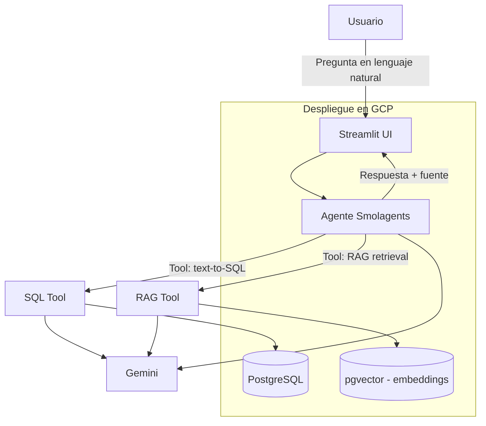

# Especificación Técnica — Pipidu Library Agent

> Documento incremental. Se irá completando/ajustando a medida que avance el diseño e implementación.
>
> **Nivel en el ciclo SDD:** Plan (HOW). Los requisitos verificables del agente y sus tools están en
> `03-especificaciones-por-capacidad.md`; la división en tareas en `04-tareas.md`; la validación en
> `05-validacion.md`.

## 1. Arquitectura general



## 2. Stack tecnológico

| Componente | Tecnología |
|---|---|
| Lenguaje | Python 3.11+ |
| Base de datos | PostgreSQL |
| Vector store | pgvector (extensión sobre el mismo PostgreSQL) |
| LLM | Google Gemini (API) para aceptación y despliegue; en desarrollo, un servidor local OpenAI-compatible vía LiteLLM (`LLM_MODEL`, `LLM_API_BASE`) para validar el flujo sin consumir cuota (R-2.8) |
| Framework agéntico | Smolagents |
| UI | Streamlit |
| Embeddings | Gemini Embeddings API (`text-embedding-004` o equivalente vigente) |
| Despliegue | GCP (Cloud Run / Compute Engine + Cloud SQL para Postgres) |
| Control de versiones | GitHub |
| ORM / acceso a datos | SQLAlchemy (o psycopg2 directo, a definir en implementación) |

## 3. Modelo de datos relacional (propuesta inicial)

> Sujeto a ajuste fino durante la implementación. Cumple el mínimo de 5 tablas (6 propuestas).

### 3.1 Tablas

**`autores`**
| Columna | Tipo | Notas |
|---|---|---|
| id | SERIAL PK | |
| nombre | VARCHAR(100) | |
| apellido | VARCHAR(100) | |
| nacionalidad | VARCHAR(50) | |
| fecha_nacimiento | DATE | opcional |

**`editoriales`**
| Columna | Tipo | Notas |
|---|---|---|
| id | SERIAL PK | |
| nombre | VARCHAR(100) | |
| pais | VARCHAR(50) | |

**`categorias`**
| Columna | Tipo | Notas |
|---|---|---|
| id | SERIAL PK | |
| nombre | VARCHAR(80) | ej. "Ciencias de la Computación", "Literatura" |
| descripcion | TEXT | |

**`libros`**
| Columna | Tipo | Notas |
|---|---|---|
| id | SERIAL PK | |
| titulo | VARCHAR(200) | |
| isbn | VARCHAR(20) | único |
| editorial_id | FK → editoriales.id | |
| categoria_id | FK → categorias.id | |
| anio_publicacion | INT | CHECK 1400–2100 |
| ejemplares_totales | INT | CHECK ≥ 0 |
| ejemplares_disponibles | INT | CHECK 0 ≤ disponibles ≤ totales |

**`libros_autores`** (relación N:M: un libro puede tener varios autores)
| Columna | Tipo | Notas |
|---|---|---|
| libro_id | FK → libros.id | PK compuesta; `ON DELETE CASCADE` |
| autor_id | FK → autores.id | PK compuesta; `ON DELETE RESTRICT` |
| orden | SMALLINT | posición del autor en el libro (1 por defecto) |

**`socios`**
| Columna | Tipo | Notas |
|---|---|---|
| id | SERIAL PK | |
| nombre | VARCHAR(100) | |
| apellido | VARCHAR(100) | |
| legajo | VARCHAR(20) | único, para alumnos |
| tipo_socio | VARCHAR(20) | 'alumno' / 'docente' |
| email | VARCHAR(100) | |
| fecha_alta | DATE | |

**`prestamos`**
| Columna | Tipo | Notas |
|---|---|---|
| id | SERIAL PK | |
| libro_id | FK → libros.id | |
| socio_id | FK → socios.id | |
| fecha_prestamo | DATE | |
| fecha_devolucion_prevista | DATE | |
| fecha_devolucion_real | DATE | NULL si aún no devuelto |
| estado | VARCHAR(20) | `activo` / `devuelto` (CHECK). **Nunca `vencido`**; ver la vista |

> **El vencimiento no se almacena** (D7, D64). La tabla guarda `activo`/`devuelto`, ligado a
> `fecha_devolucion_real` por un CHECK (`devuelto` ⇔ fecha real no nula). El estado `vencido` se calcula
> en la vista **`v_prestamos_estado`** (`id, libro_id, socio_id, fecha_prestamo,
> fecha_devolucion_prevista, fecha_devolucion_real, estado, estado_calculado, dias_atraso`):
> `estado_calculado` es `devuelto` si `estado = 'devuelto'`, `vencido` si la fecha prevista es anterior a
> `CURRENT_DATE`, y `activo` en otro caso. `dias_atraso` es los días vencidos de un préstamo activo, o
> los días de retraso con que se devolvió uno devuelto tarde (0 si no hubo). La vista es la única fuente
> de "vencido": `prestamos.estado = 'vencido'` nunca devuelve filas.

### 3.2 Relaciones

- `libros.editorial_id` → `editoriales.id` (N:1)
- `libros.categoria_id` → `categorias.id` (N:1)
- `libros_autores.libro_id` → `libros.id` y `libros_autores.autor_id` → `autores.id` (N:M)
- `prestamos.libro_id` → `libros.id` (N:1)
- `prestamos.socio_id` → `socios.id` (N:1)
- `documentos_chunks.documento_id` → `documentos.id` (N:1, `ON DELETE CASCADE`)

### 3.2.1 Repositorio documental (RAG)

| Tabla | Columnas relevantes |
|---|---|
| `documentos` | `id`, `nombre_archivo` (único), `tipo` (`reglamento`/`manual`/`politica`/`resena`), `bucket_key`, `sha256`, `creado_en` |
| `documentos_chunks` | `id`, `documento_id`, `chunk_index` (único por documento), `contenido`, `embedding vector(768)`, `metadata jsonb` |

La herramienta de recuperación lee estas dos tablas (D66). La ubicación citable de un fragmento
(R-4.7) sale de `metadata` (`seccion`, `ubicacion` o `pagina`); si la ingesta no la guarda, la cita queda
como "fragmento N". El índice HNSW usa `vector_cosine_ops` (D13). La herramienta SQL **no** puede leerlas
(D21).

### 3.2.2 Trazabilidad `agent_runs` (R-6.x)

Una fila por consulta, resuelta o no (`db/migrations/001_agent_runs.sql`). Se escribe con el rol
`agent_logger`, que solo puede `INSERT`; `agent_ro` no la ve (D63).

| Columna | Origen / requisito |
|---|---|
| `created_at` | timestamp (R-6.1) |
| `question`, `classification`, `answer`, `latency_ms` | R-6.1 |
| `tools` | herramientas invocadas, en orden (R-6.1) |
| `generated_sql` / `executed_sql` | sentencia del modelo / normalizada que corrió (R-6.1, R-3.9) |
| `chunks` (jsonb) | fragmentos recuperados (R-6.1) |
| `status` | `ok` \| `no_coverage` \| `error` (R-6.3) |
| `error_code`, `error_detail` | motivo del rechazo o fallo (R-6.3) |
| `attempts` (jsonb) | cada intento de generación con su resultado (R-6.4) |
| `model_id`, `endpoint` | modelo y `local` \| `api` (R-6.5) |
| `sources`, `trace` | fuentes efectivamente usadas; orden de eventos con la clasificación primero |

El registro se arma solo desde el `AgentAnswer`. Si la base de trazabilidad no responde, la consulta se
contesta igual y el fallo queda en `evidence["run_recording_error"]`: registrar no puede romper la
respuesta, pero tampoco se finge que se registró.

### 3.2.3 Entorno local con Docker

`docker compose up -d --wait db` levanta PostgreSQL + pgvector y ejecuta `db/init/10-roles.sh`: crea
los roles `agent_ro` y `agent_logger`, aplica `db/schema.sql`, `db/migrations/001_agent_runs.sql`, los
permisos (`db/post_restore.sql`) y, por defecto, `db/dev_seed.sql` (pocas filas deterministas con
fechas relativas a `CURRENT_DATE`). `scripts/replicate_neon.sh` trae el esquema y los datos de Neon con
`pg_dump` desde un contenedor, solo lectura y sin imprimir la connection string.

### 3.3 Datos sintéticos

- Generación programática (ej. con `Faker` para nombres/fechas + reglas de negocio simples para consistencia de disponibilidad de ejemplares).
- Volumen objetivo: **15-20 registros por tabla** (mínimo exigido: 15).
- Script de seed versionado en el repo (`scripts/seed_data.py` o similar).

## 4. Repositorio documental para RAG

| Documento | Tipo de contenido |
|---|---|
| `reglamento_biblioteca.pdf` | Normas de préstamo, sanciones, plazos, horarios |
| `politicas_universidad.pdf` | Políticas institucionales generales |
| `resenas_libro_1.pdf` … `resenas_libro_3.pdf` | Sinopsis/reseñas de 1 a 3 libros del catálogo |

Total: entre 4 y 6 PDFs (mínimo exigido: 2).

### 4.1 Pipeline de ingesta RAG

1. Extracción de texto de los PDFs (`pypdf` / `pdfplumber`).
2. Chunking (ej. 500-1000 tokens con overlap).
3. Generación de embeddings (Gemini Embeddings API).
4. Almacenamiento en `pgvector`: un registro en `documentos` y un fragmento por fila en
   `documentos_chunks` (`embedding vector(768)`, `metadata jsonb` con la ubicación citable). Ver §3.2.1.
5. Retrieval por similitud coseno (top-k) en tiempo de consulta.

## 5. Arquitectura del agente

### 5.1 Framework: Smolagents

El agente se implementa como un **`ToolCallingAgent`** de Smolagents (D2) con las siguientes **tools**:

| Tool | Descripción |
|---|---|
| `execute_sql` | Recibe la sentencia **ya formada por el agente**, la valida estáticamente con `sqlglot`, la ejecuta con el usuario `agent_ro` y devuelve el resultado tabular |
| `rag_search_tool` | Recibe una pregunta en NL, busca los chunks más relevantes en pgvector y los devuelve como contexto |

No existe `hybrid_tool`: la combinación de fuentes es una decisión del orquestador, no una tool. El
agente invoca una o ambas según la clasificación (R-2.4).

**Proveedor configurable (D56).** El proveedor se elige por configuración, no por código:
`LLM_MODEL` en formato LiteLLM (`gemini/<modelo>` por defecto, o `openai/<id>` con `LLM_API_BASE` para un
servidor local) y `LLM_API_KEY`. Procedimiento: (1) validar el flujo contra el modelo local; (2) cambiar a
Gemini con `GEMINI_API_KEY` y repetir el golden set completo; (3) versionar esa corrida en
`TP/evidencia/` con el modelo usado. Los resultados con el modelo local validan el flujo y **no** el
criterio de aceptación R-2.1. El clasificador usa salida estructurada nativa con Gemini y `json_object`
con cualquier otro proveedor, validado contra el mismo vocabulario (`sql`, `rag`, `hybrid`, `none`). Ante
un límite de cuota (429) se reintenta con la espera que informa la API (D57).

El LLM (Gemini) actúa como **orquestador**: clasifica la consulta mediante salida estructurada
obligatoria (R-2.7), decide qué tool(s) invocar, genera el SQL y redacta la respuesta final. La
diferencia con el diseño anterior es que **el SQL lo genera el agente, no la tool** (D1): así la tool
puede testearse sin credenciales de API y el SQL queda atribuido al agente.

### 5.2 Seguridad en generación de SQL

- Prompt del sistema restringe la generación a sentencias `SELECT` sobre el esquema documentado, con la
  semántica temporal resuelta desde configuración (rango de cuatrimestre y zona horaria, D6).
- Validación adicional en código mediante **parseo con `sqlglot`** (D4), con `error_level=RAISE` para
  que una sentencia mal formada falle en vez de degradar a una interpretación genérica:
  - statement raíz `SELECT`/`WITH` (y operaciones de conjunto): se rechaza cualquier statement que no
    sea lectura, incluyendo `DROP`, `DELETE`, `UPDATE`, `INSERT`, `TRUNCATE`, `GRANT`, `COPY`, `CALL`,
    `EXEC` y las cláusulas de bloqueo (`FOR UPDATE`),
  - rechazo de cláusulas de bloqueo (`FOR UPDATE`),
  - extracción de tablas y columnas contra la whitelist, con identificadores normalizados a minúsculas
    (`FROM "Libros"` no se rechaza falsamente),
  - `SELECT *` se **expande a las columnas de la whitelist** antes de ejecutar: sin esto la whitelist de
    columnas es evadible y una columna física del esquema se puede alcanzar aunque no esté documentada,
  - **allowlist de funciones** (R-3.13): `pg_sleep`, `pg_read_file`, `dblink`, `pg_advisory_lock` se
    rechazan porque el timeout limita el tiempo pero no los efectos,
  - rechazo de `;` y comentarios — **mitigación de SQL injection vía LLM**.
- La sentencia registrada y exhibida es la **normalizada** (la que se ejecuta), no la original del
  modelo; `SqlResult.sql_original` conserva la versión del modelo para la trazabilidad (R-3.9, R-6.4).
- El fallo de ejecución se reporta como `EXECUTION_ERROR` (R-3.16): la herramienta no reinterpreta el
  mensaje de la base ni completa hechos desde fuera del resultado. Una sentencia rechazada por la
  validación nunca abre conexión.
- Conexión a BD con usuario dedicado **`agent_ro`** (`GRANT SELECT` sobre las 7 tablas del dominio y la
  vista `v_prestamos_estado`; sobre `documentos_chunks` solo para la herramienta de recuperación;
  sin acceso a `agent_runs`, que escribe `agent_logger` con solo `INSERT`, D63),
  `statement_timeout = 10000`, `search_path` restringido) como defensa en profundidad (D14).
- Regeneración de sentencia limitada a **2 intentos** (D8); al segundo rechazo se reporta el error al
  usuario (R-3.10, R-5.7).

### 5.3 Prompt engineering

- Prompt de sistema con: rol del agente, esquema de la base de datos (DDL resumido), instrucciones de cuándo usar SQL vs RAG, formato de respuesta esperado.
- Few-shot examples de preguntas NL → SQL para mejorar precisión del text-to-SQL.

### 5.4 Contratos de las tools

> Definir estos contratos **antes** de implementar, porque son la frontera que permite que tres
> integrantes trabajen en paralelo y que los tests de `T8` no dependan del resto.

**`execute_sql(sql: str) -> SqlResult`**

```python
@dataclass
class SqlResult:
    sql: str | None          # sentencia efectivamente ejecutada (normalizada, R-3.9)
    rows: list[dict]         # filas devueltas (<= 50)
    error: str | None        # SQL_NOT_READONLY | TABLE_NOT_ALLOWED | COLUMN_NOT_ALLOWED | FUNCTION_NOT_ALLOWED | TIMEOUT | EXECUTION_ERROR | None
    executed: bool           # False si la validación estática rechazó la sentencia
    attempts: int            # intentos de generación hasta llegar a esta sentencia (D8)
    latency_ms: int
    sql_original: str | None  # como la produjo el modelo; puede diferir de `sql` (R-6.4)
```

**`rag_search_tool(question: str) -> RagResult`**

```python
@dataclass
class RagResult:
    chunks: list[Chunk]      # top-k por similitud de coseno
    error: str | None        # NO_RELEVANT_RESULTS | None
    latency_ms: int

@dataclass
class Chunk:
    id: int
    document: str            # nombre del PDF de origen
    location: str            # página o sección
    text: str
    content_hash: str        # sha256(contenido), unique para idempotencia (D11)
    similarity: float
```

**Contrato del orquestador**

```python
@dataclass
class AgentAnswer:
    question: str
    classification: str      # sql | rag | hybrid | none
    sources: list[str]       # fuentes efectivamente usadas
    answer: str
    evidence: dict           # sql ejecutado y/o chunks citados
    run_id: int              # fila correspondiente en agent_runs
```

Regla derivada del Art. 4 de la constitución: `sources` nunca puede estar vacío sin que `answer`
declare explícitamente la ausencia de información.

## 6. Interfaz de usuario (Streamlit)

- Campo de texto para la consulta en lenguaje natural.
- Historial de conversación (opcional, usando `st.session_state`).
- Panel que muestra qué fuente(s) usó el agente (SQL / RAG) y, opcionalmente, el SQL generado o los fragmentos de PDF recuperados (transparencia/explicabilidad).

## 7. Despliegue en GCP

- **Opción recomendada:** Cloud Run para el servicio (UI + agente) + Cloud SQL (PostgreSQL con pgvector) para la base.
- Variables de entorno gestionadas vía Secret Manager (API key de Gemini, credenciales de BD).
- Dockerfile para empaquetar la app Streamlit + agente.

## 8. Estructura de repositorio propuesta

```
pipidu-library-agent/
├── README.md
├── requirements.txt
├── pytest.ini
├── .env.example
├── docker/
│   ├── Dockerfile
│   └── docker-compose.yml
├── db/
│   ├── schema.sql          # 7 tablas del dominio + documentos(+chunks) + vista v_prestamos_estado
│   ├── migrations/         # 001_agent_runs.sql (trazabilidad, R-6.x)
│   ├── init/               # roles agent_ro / agent_logger y orden de inicialización (Docker)
│   ├── post_restore.sql    # permisos de agent_ro tras crear o restaurar el esquema
│   ├── dev_seed.sql        # datos de desarrollo (no es el seed entregable)
│   ├── seed_data.py
│   └── dump.sql
├── rag/
│   ├── documents/          # PDFs fuente
│   ├── chunking.py
│   └── ingest.py
├── agent/
│   ├── config/
│   │   ├── __init__.py     # Config desde entorno (D6, D12, D15)
│   │   └── schema_whitelist.py
│   ├── contracts.py        # SqlResult, Chunk, RagResult, AgentAnswer
│   ├── errors.py           # SQL_NOT_READONLY, TABLE_NOT_ALLOWED, COLUMN_NOT_ALLOWED, FUNCTION_NOT_ALLOWED, TIMEOUT, EXECUTION_ERROR
│   ├── sql_validator.py    # validación estática con sqlglot (D4)
│   ├── prompts/system_prompt.md
│   ├── tools/
│   │   ├── sql_tool.py     # execute_sql: valida y ejecuta, no genera SQL (D1)
│   │   └── rag_tool.py
│   └── agent.py            # ToolCallingAgent (D2)
├── ui/
│   └── app.py              # Streamlit
├── TP/                     # artefactos SDD legibles para la entrega
├── informe/
│   └── informe_tecnico.pdf
└── tests/
    ├── golden_set.py       # fixtures compartidas (D16)
    ├── test_sql_validator.py
    ├── test_rag_tool.py
    ├── test_golden_set.py
    └── test_contracts.py
```

## 9. Plan de pruebas

- Unit tests sobre `sql_tool` (validación de sanitización, ejecución correcta de queries conocidas).
- Unit tests sobre `rag_tool` (retrieval devuelve chunks esperados para preguntas de prueba).
- Casos de prueba end-to-end: set de preguntas de ejemplo (SQL puras, RAG puras, mixtas) con respuesta esperada, documentadas en el informe técnico como evidencia.

## 10. Metodología SDD (artefactos a entregar)

1. Este documento + `01-especificacion-funcional.md` (versión inicial, previa a implementación)
2. Actualizaciones incrementales de ambos documentos a medida que se tomen decisiones de diseño durante el desarrollo
3. Changelog informal de decisiones relevantes (al final de cada documento o en un `CHANGELOG.md` dentro de `TP/`)

## 11. Pendientes técnicos (cerrados el 2026-10-10)

Los cuatro pendientes originales se cerraron en `CHANGELOG.md`:

- Capa de acceso a datos: **psycopg2 directo** (D9).
- Estrategia de chunking: **por cláusula, tope 800 tokens / 150 de solapamiento** (D10).
- Memoria conversacional: **single-turn**, historial solo visual (D17).
- Despliegue: **Cloud Run + Cloud SQL + Secret Manager** (D18).

Queda un pendiente numérico, no conceptual: el umbral de similitud definitivo (D12), que se cierra con
la medición de T3.6.
