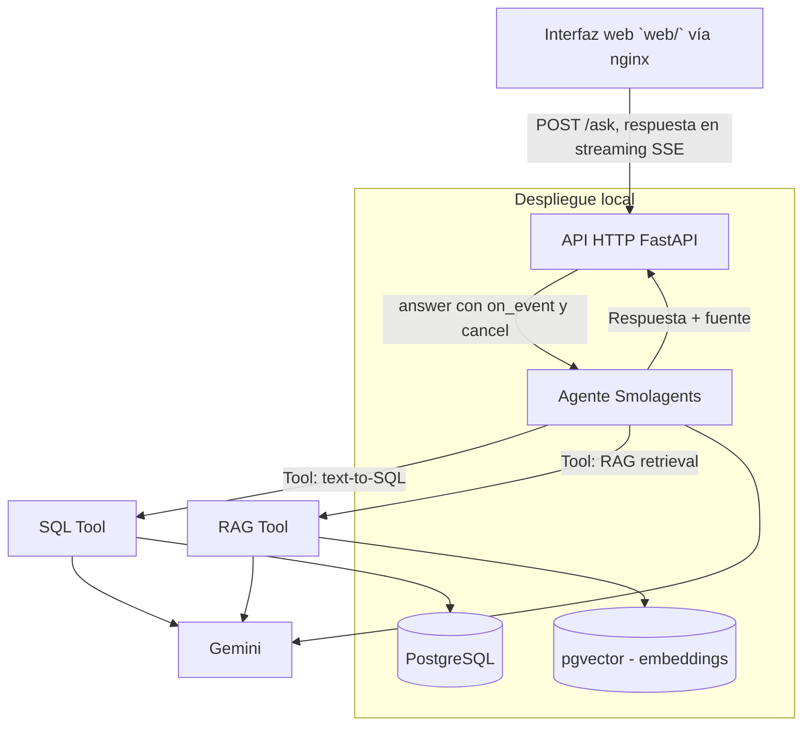

# Especificación Técnica — Pipidu Library Agent

> Documento incremental. Se irá completando/ajustando a medida que avance el diseño e implementación.
>
> **Nivel en el ciclo SDD:** Plan (HOW). Los requisitos verificables del agente y sus tools están en
> `openspec/changes/agente-y-tools/specs/<capacidad>/spec.md`; la división en tareas en
> `openspec/changes/agente-y-tools/tasks.md`; la validación en `05-validacion.md`.

## 1. Arquitectura general



## 2. Stack tecnológico

| Componente | Tecnología |
|---|---|
| Lenguaje | Python 3.12+ (el código usa sintaxis de 3.12; `target-version = "py312"` en `pyproject.toml`) |
| Base de datos | PostgreSQL |
| Vector store | pgvector (extensión sobre el mismo PostgreSQL) |
| LLM | Google Gemini (API) para aceptación y ejecución del sistema (D81); en desarrollo, un servidor local OpenAI-compatible vía LiteLLM (`LLM_MODEL`, `LLM_API_BASE`) para validar el flujo sin consumir cuota (R-2.8) |
| Framework agéntico | Smolagents |
| Acceso al agente | API HTTP con FastAPI + uvicorn y respuesta en streaming SSE (D75, D80, `consulta-por-api`). El servidor del agente no sirve interfaz: la SPA de `web/` (D93) es un cliente de la API |
| Embeddings | Gemini Embeddings API, `gemini-embedding-001` con `output_dimensionality = 768` (D5) |
| Despliegue | **Entorno local** (Docker + `uvicorn`), D81. La alternativa de nube queda registrada en §7 |
| Control de versiones | GitHub |
| ORM / acceso a datos | psycopg2 directo, sin ORM (D9) |

## 3. Modelo de datos relacional

> Modelo adoptado (D64): el esquema versionado en `db/schema.sql`, verificado contra el código. Son 7 tablas
> del dominio — `autores`, `editoriales`, `categorias`, `libros`, `libros_autores`, `socios`, `prestamos` —
> más el repositorio documental (§3.2.1) y la vista `v_prestamos_estado`. El DDL no se copia acá: vive en
> `db/schema.sql`.

### 3.1 Tablas

**`autores`**
| Columna | Tipo | Notas |
|---|---|---|
| id | SERIAL PK | |
| nombre | VARCHAR(100) | |
| apellido | VARCHAR(100) | |
| nacionalidad | VARCHAR(50) | |
| fecha_nacimiento | DATE | opcional |

**`editoriales`**
| Columna | Tipo | Notas |
|---|---|---|
| id | SERIAL PK | |
| nombre | VARCHAR(100) | |
| pais | VARCHAR(50) | |

**`categorias`**
| Columna | Tipo | Notas |
|---|---|---|
| id | SERIAL PK | |
| nombre | VARCHAR(80) | ej. "Ciencias de la Computación", "Literatura" |
| descripcion | TEXT | |

**`libros`**
| Columna | Tipo | Notas |
|---|---|---|
| id | SERIAL PK | |
| titulo | VARCHAR(200) | |
| isbn | VARCHAR(20) | único |
| editorial_id | FK → editoriales.id | |
| categoria_id | FK → categorias.id | |
| anio_publicacion | INT | CHECK 1400–2100 |
| ejemplares_totales | INT | CHECK ≥ 0 |
| ejemplares_disponibles | INT | CHECK 0 ≤ disponibles ≤ totales |

**`libros_autores`** (relación N:M: un libro puede tener varios autores)
| Columna | Tipo | Notas |
|---|---|---|
| libro_id | FK → libros.id | PK compuesta; `ON DELETE CASCADE` |
| autor_id | FK → autores.id | PK compuesta; `ON DELETE RESTRICT` |
| orden | SMALLINT | posición del autor en el libro (1 por defecto) |

**`socios`**
| Columna | Tipo | Notas |
|---|---|---|
| id | SERIAL PK | |
| nombre | VARCHAR(100) | |
| apellido | VARCHAR(100) | |
| legajo | VARCHAR(20) | único, para alumnos |
| tipo_socio | VARCHAR(20) | 'alumno' / 'docente' |
| email | VARCHAR(100) | |
| fecha_alta | DATE | |

**`prestamos`**
| Columna | Tipo | Notas |
|---|---|---|
| id | SERIAL PK | |
| libro_id | FK → libros.id | |
| socio_id | FK → socios.id | |
| fecha_prestamo | DATE | |
| fecha_devolucion_prevista | DATE | |
| fecha_devolucion_real | DATE | NULL si aún no devuelto |
| estado | VARCHAR(20) | `activo` / `devuelto` (CHECK). **Nunca `vencido`**; ver la vista |

> **El vencimiento no se almacena** (D7, D64). La tabla guarda `activo`/`devuelto`, ligado a
> `fecha_devolucion_real` por un CHECK (`devuelto` ⇔ fecha real no nula). El estado `vencido` se calcula
> en la vista **`v_prestamos_estado`** (`id, libro_id, socio_id, fecha_prestamo,
> fecha_devolucion_prevista, fecha_devolucion_real, estado, estado_calculado, dias_atraso`):
> `estado_calculado` es `devuelto` si `estado = 'devuelto'`, `vencido` si la fecha prevista es anterior a
> `CURRENT_DATE`, y `activo` en otro caso. `dias_atraso` es los días vencidos de un préstamo activo, o
> los días de retraso con que se devolvió uno devuelto tarde (0 si no hubo). La vista es la única fuente
> de "vencido": `prestamos.estado = 'vencido'` nunca devuelve filas.

### 3.2 Relaciones

- `libros.editorial_id` → `editoriales.id` (N:1)
- `libros.categoria_id` → `categorias.id` (N:1)
- `libros_autores.libro_id` → `libros.id` y `libros_autores.autor_id` → `autores.id` (N:M)
- `prestamos.libro_id` → `libros.id` (N:1)
- `prestamos.socio_id` → `socios.id` (N:1)
- `documentos_chunks.documento_id` → `documentos.id` (N:1, `ON DELETE CASCADE`)

### 3.2.1 Repositorio documental (RAG)

| Tabla | Columnas relevantes |
|---|---|
| `documentos` | `id`, `nombre_archivo` (único), `tipo` (`reglamento`/`manual`/`politica`/`resena`), `bucket_key`, `sha256`, `creado_en` |
| `documentos_chunks` | `id`, `documento_id`, `chunk_index` (único por documento), `contenido`, `embedding vector(768)`, `metadata jsonb` |

La herramienta de recuperación lee estas dos tablas (D66); qué columnas exactas lee está en §3.4. La ubicación citable de un fragmento
(R-4.7) sale de `metadata` (`seccion`, `ubicacion` o `pagina`); si la ingesta no la guarda, la cita queda
como "fragmento N". El índice HNSW usa `vector_cosine_ops` (D13). La herramienta SQL **no** puede leerlas
(D21).

### 3.2.2 Trazabilidad `agent_runs` (R-6.x)

Una fila por consulta, resuelta o no (`db/migrations/001_agent_runs.sql`). Se escribe con el rol
`agent_logger`, que solo puede `INSERT`; `agent_ro` no la ve (D63).

| Columna | Origen / requisito |
|---|---|
| `created_at` | timestamp (R-6.1) |
| `question`, `classification`, `answer`, `latency_ms` | R-6.1 |
| `tools` | herramientas invocadas, en orden (R-6.1) |
| `generated_sql` / `executed_sql` | sentencia del modelo / normalizada que corrió (R-6.1, R-3.9) |
| `chunks` (jsonb) | fragmentos recuperados (R-6.1) |
| `status` | `ok` \| `no_coverage` \| `error` (R-6.3) |
| `error_code`, `error_detail` | motivo del rechazo o fallo (R-6.3) |
| `attempts` (jsonb) | cada intento de generación con su resultado (R-6.4) |
| `model_id`, `endpoint` | modelo y `local` \| `api` (R-6.5) |
| `sources`, `trace` | fuentes efectivamente usadas; orden de eventos con la clasificación primero |

El registro se arma solo desde el `AgentAnswer`. Si la base de trazabilidad no responde, la consulta se
contesta igual y el fallo queda en `evidence["run_recording_error"]`: registrar no puede romper la
respuesta, pero tampoco se finge que se registró.

### 3.2.3 Entorno local con Docker

`docker compose up -d --wait` levanta PostgreSQL + pgvector (`db`), ingesta el RAG (`ingest`, D92) y arranca la
API y la web. `db` ejecuta `db/init/10-roles.sh` al crear el volumen: crea los roles `agent_ro` y
`agent_logger`, aplica `db/schema.sql`, `db/migrations/001_agent_runs.sql`, los permisos (`db/post_restore.sql`) y
el seed que elige `DEV_SEED`: `full` (por defecto, D91) = `db/seed.sql`, el catálogo completo; `1` =
`db/dev_seed.sql` (pocas filas deterministas con fechas relativas a `CURRENT_DATE`, lo que esperan los tests de
integración); `0` = base vacía. `scripts/replicate_neon.sh` trae el esquema y los datos de Neon con
`pg_dump` desde un contenedor, solo lectura y sin imprimir la connection string.

### 3.3 Datos sintéticos

- Generación programática (ej. con `Faker` para nombres/fechas + reglas de negocio simples para consistencia de disponibilidad de ejemplares).
- Volumen objetivo: **15-20 registros por tabla** (mínimo exigido: 15).
- Script de seed versionado en el repo (`db/seed_data.py`, pendiente: T2.4).

### 3.4 Contrato de datos que lee el agente

Lo que el agente lee, verificado contra el código (no contra la propuesta inicial). Es el único lugar donde
se enuncia este contrato: el DDL no se copia acá, vive en `db/schema.sql`; la lista vinculante de tablas y
columnas para la herramienta SQL es `agent/config/schema_whitelist.py` (R-3.4).

Verificación: `tests/test_schema_whitelist.py` (esquema ↔ whitelist, bidireccional) y
`tests/test_seed_contract.py` (este apartado ↔ whitelist/esquema, y el volumen y las reglas de consistencia
contra la base real con el rol `agent_ro`). Las entidades del seed que nombran los casos G1–G5 las verifica
`tests/test_golden_seed.py`; acá no se repiten esas afirmaciones.

#### 3.4.1 Objetos y columnas que lee el agente

| Objeto (`db/schema.sql`) | Columnas que lee el agente | Vía |
|---|---|---|
| `autores` | `id`, `nombre`, `apellido`, `nacionalidad`, `fecha_nacimiento` | SQL (whitelist) |
| `editoriales` | `id`, `nombre`, `pais` | SQL (whitelist) |
| `categorias` | `id`, `nombre`, `descripcion` | SQL (whitelist) |
| `libros` | `id`, `titulo`, `isbn`, `editorial_id`, `categoria_id`, `anio_publicacion`, `ejemplares_totales`, `ejemplares_disponibles` | SQL (whitelist) |
| `libros_autores` | `libro_id`, `autor_id`, `orden` | SQL (whitelist) |
| `socios` | `id`, `nombre`, `apellido`, `legajo`, `tipo_socio`, `email`, `fecha_alta` | SQL (whitelist) |
| `prestamos` | `id`, `libro_id`, `socio_id`, `fecha_prestamo`, `fecha_devolucion_prevista`, `fecha_devolucion_real`, `estado` | SQL (whitelist) |
| `v_prestamos_estado` | `id`, `libro_id`, `socio_id`, `fecha_prestamo`, `fecha_devolucion_prevista`, `fecha_devolucion_real`, `estado`, `estado_calculado`, `dias_atraso` | SQL (whitelist) |
| `documentos` | `id`, `nombre_archivo`, `sha256` | RAG (`PgVectorStore`); fuera de la whitelist SQL (D21) |
| `documentos_chunks` | `id`, `documento_id`, `chunk_index`, `contenido`, `embedding`, `metadata` | RAG (`PgVectorStore`); fuera de la whitelist SQL (D21) |

El rol `agent_ro` necesita `GRANT SELECT` sobre los diez objetos (`db/post_restore.sql`), incluidas las dos
tablas documentales: la herramienta de recuperación las lee por una conexión propia y necesita el JOIN
`documentos` ↔ `documentos_chunks` para el nombre del PDF y el `sha256` del documento.

Pendiente para la parte de datos: el comentario de `db/post_restore.sql` dice que `documentos` queda fuera de
los permisos, pero la lista de `GRANT` lo incluye. El comportamiento correcto es el que necesita
`agent/tools/rag_tool.py` (SELECT concedido); el comentario está desalineado y lo corrige el integrante de BD.

#### 3.4.2 Lo que los casos G1–G5 y la semántica temporal necesitan del seed

Las entidades son las de `tests/golden_set.py::SEED_ENTITIES`; las filas nombradas son las de
`db/dev_seed.sql` (`DEV_SEED=1`), que es la foto de la base de pruebas; el catálogo completo (`db/seed.sql`) conserva esas entidades.

| Caso | Qué necesita del seed | Entidades / filas de las que depende |
|---|---|---|
| G1 | un socio con al menos un préstamo | `socios` Juan Pérez (`A-1001`) y sus `prestamos` |
| G2 | al menos un préstamo con `fecha_prestamo` dentro del rango configurado (`CUATRIMESTRE_START` / `CUATRIMESTRE_END`, D6, R-3.11); el ranking no puede quedar vacío | los 11 `prestamos` de `dev_seed.sql` caen en el rango solo mientras `CURRENT_DATE` esté dentro de él: el seed entregable debe fijar fechas dentro del rango, no solo relativas a `CURRENT_DATE` |
| G3 | al menos una fila con `estado_calculado = 'vencido'` en `v_prestamos_estado`; el seed **no** escribe `vencido` (D7, R-3.12) | `A-1001` (préstamo de hace 20 días) y `A-1003` (hace 35 días) |
| G4 | la categoría con libros y `ejemplares_disponibles > 0` | `categorias` Ciencias de la Computación; `libros` Sistemas Operativos Modernos y Redes de Computadoras |
| G5 | la editorial con libros vinculados a autores por `libros_autores` (no existe `libros.autor_id`, D64) | `editoriales` Sudamericana; `libros_autores` |
| G13 | el libro existe y el modelo de datos **no** registra precio → la respuesta declara ausencia (Art. 4) | `libros` Rayuela |
| R-3.8 | un socio sin préstamos, para el caso de resultado vacío | `socios` Sofía Díaz (`A-1004`) |

Reglas de consistencia que el seed debe cumplir (T2.7): `ejemplares_disponibles <= ejemplares_totales` en
`libros`, y todo préstamo vencido satisface `fecha_devolucion_real IS NULL AND CURRENT_DATE >
fecha_devolucion_prevista`, resuelto por la vista y no por un valor escrito.

Volumen (T2.5): >= 15 filas en cada una de las 7 tablas del dominio de la tabla de §3.4.1 (la vista no
cuenta). El caso de `documentos` se resuelve en 2.9. Los conteos medidos se registran en `tasks.md` 2.5.

#### 3.4.3 Lo que la recuperación necesita de la ingesta

| Qué | Qué debe cumplir la ingesta |
|---|---|
| Nombre del documento | `documentos.nombre_archivo` guarda el nombre del PDF con extensión y el prefijo que comparan los casos: `reglamento_biblioteca`, `resenas_`, `resenas_tolkien`, `resenas_empyrean` (D55, D86, D87) |
| Ubicación citable | `metadata` con `seccion`, `ubicacion` o `pagina`; si la ingesta no la guarda, la cita queda como "fragmento N" (R-4.7, D66) |
| Vector | `embedding vector(768)` con `gemini-embedding-001` y `output_dimensionality = 768` (D5); documentos con `task_type = RETRIEVAL_DOCUMENT` y la consulta con `RETRIEVAL_QUERY` |
| Distancia | coseno (`<=>`), similitud = 1 − distancia; índice HNSW declarado con `vector_cosine_ops` (D13) |
| Idempotencia | `sha256` es la clave de idempotencia (D11, R-4.5). En `db/schema.sql` el UNIQUE está sobre `nombre_archivo` y sobre `(documento_id, chunk_index)`, **no** sobre `sha256`: la ingesta debe hacer upsert por `nombre_archivo` (o se agrega el UNIQUE, lo define la parte de BD). Reejecutar la ingesta no cambia el conteo de chunks |
| Identidad del fragmento | el `Chunk` que devuelve la tool lleva `document` = `nombre_archivo` y `content_hash` = `sha256` + `:` + `chunk_index` (D66) |

Resuelto (D87): el nombre almacenado en `documentos.nombre_archivo` es el del PDF real (`resenas_tolkien.pdf`, etc.) y
el golden set compara por prefijo (`resenas_`, o el de la saga cuando el caso la nombra).

## 4. Repositorio documental para RAG

| Documento | Tipo de contenido |
|---|---|
| `reglamento_biblioteca.pdf` | Normas de préstamo, sanciones, plazos, horarios |
| `politicas_universidad.pdf` | Políticas institucionales generales |
| `resenas_cien_anios_de_soledad.pdf`, `resenas_clean_code.pdf`, `resenas_tolkien.pdf`, `resenas_empyrean.pdf` | Reseñas de libros y sagas del catálogo |

Total: entre 4 y 6 PDFs (mínimo exigido: 2).

### 4.1 Pipeline de ingesta RAG

1. Lectura del texto fuente: `rag/documents/*.md` (el PDF de `rag/documents/pdf/` se genera con el mismo texto,
   `rag/build_pdfs.py`, y aporta el `sha256` de idempotencia).
2. Chunking por sección `## ` (un fragmento por artículo o paso numerado, con el título del documento antepuesto),
   sin tope de tokens ni solapamiento (D97, que reemplaza a D10 en este punto).
3. Generación de embeddings (Gemini Embeddings API).
4. Almacenamiento en `pgvector`: un registro en `documentos` y un fragmento por fila en
   `documentos_chunks` (`embedding vector(768)`, `metadata jsonb` con la ubicación citable). Ver §3.2.1.
5. Retrieval por similitud coseno (top-k) en tiempo de consulta.

## 5. Arquitectura del agente

### 5.1 Framework: Smolagents

El agente se implementa como un **`ToolCallingAgent`** de Smolagents (D2) con las siguientes **tools**:

| Tool | Descripción |
|---|---|
| `execute_sql` | Recibe la sentencia **ya formada por el agente**, la valida estáticamente con `sqlglot`, la ejecuta con el usuario `agent_ro` y devuelve el resultado tabular |
| `rag_search_tool` | Recibe una pregunta en NL, busca los chunks más relevantes en pgvector y los devuelve como contexto |

Nomenclatura: `rag_search_tool` es el nombre lógico que usan los artefactos SDD (specs, `tasks.md`); al
modelo la herramienta se le expone como `retrieve_documents` (`agent/agent.py`, `TOOL_RETRIEVE`). En el
código la implementación es `RagRetriever` (`agent/tools/rag_tool.py`) y el adaptador de Smolagents es
`QueryTool` (`agent/tools/smol_tools.py`).

No existe `hybrid_tool`: la combinación de fuentes es una decisión del orquestador, no una tool. El
agente invoca una o ambas según la clasificación (R-2.4).

**Proveedor configurable (D56).** El proveedor se elige por configuración, no por código:
`LLM_MODEL` en formato LiteLLM (`gemini/<modelo>` por defecto, o `openai/<id>` con `LLM_API_BASE` para un
servidor local) y `LLM_API_KEY`. Procedimiento: (1) validar el flujo contra el modelo local; (2) cambiar a
Gemini con `GEMINI_API_KEY` y repetir el golden set completo; (3) versionar esa corrida en
`TP/evidencia/` con el modelo usado. Los resultados con el modelo local validan el flujo y **no** el
criterio de aceptación R-2.1. El clasificador usa salida estructurada nativa con Gemini y `json_object`
con cualquier otro proveedor, validado contra el mismo vocabulario (`sql`, `rag`, `hybrid`, `none`). Ante
un límite de cuota (429) se reintenta con la espera que informa la API (D57).

El LLM (Gemini) actúa como **orquestador**: clasifica la consulta mediante salida estructurada
obligatoria (R-2.7), decide qué tool(s) invocar, genera el SQL y redacta la respuesta final. La
diferencia con el diseño anterior es que **el SQL lo genera el agente, no la tool** (D1): así la tool
puede testearse sin credenciales de API y el SQL queda atribuido al agente.

### 5.2 Seguridad en generación de SQL

- Prompt del sistema restringe la generación a sentencias `SELECT` sobre el esquema documentado, con la
  semántica temporal resuelta desde configuración (rango de cuatrimestre y zona horaria, D6).
- Validación adicional en código mediante **parseo con `sqlglot`** (D4), con `error_level=RAISE` para
  que una sentencia mal formada falle en vez de degradar a una interpretación genérica:
  - statement raíz `SELECT`/`WITH` (y operaciones de conjunto): se rechaza cualquier statement que no
    sea lectura, incluyendo `DROP`, `DELETE`, `UPDATE`, `INSERT`, `TRUNCATE`, `GRANT`, `COPY`, `CALL`,
    `EXEC` y las cláusulas de bloqueo (`FOR UPDATE`),
  - extracción de tablas y columnas contra la whitelist, con identificadores normalizados a minúsculas
    (`FROM "Libros"` no se rechaza falsamente),
  - `SELECT *` se **expande a las columnas de la whitelist** antes de ejecutar: sin esto la whitelist de
    columnas es evadible y una columna física del esquema se puede alcanzar aunque no esté documentada,
  - **allowlist de funciones** (R-3.13): `pg_sleep`, `pg_read_file`, `dblink`, `pg_advisory_lock` se
    rechazan porque el timeout limita el tiempo pero no los efectos,
  - rechazo de `;` y comentarios — **mitigación de SQL injection vía LLM**.
- La sentencia registrada y exhibida es la **normalizada** (la que se ejecuta), no la original del
  modelo; `SqlResult.sql_original` conserva la versión del modelo para la trazabilidad (R-3.9, R-6.4).
- El fallo de ejecución se reporta como `EXECUTION_ERROR` (R-3.16): la herramienta no reinterpreta el
  mensaje de la base ni completa hechos desde fuera del resultado. Una sentencia rechazada por la
  validación nunca abre conexión.
- Conexión a BD con usuario dedicado **`agent_ro`** (`GRANT SELECT` sobre las 7 tablas del dominio, la
  vista `v_prestamos_estado` y los objetos documentales que lee la herramienta de recuperación, según
  §3.4.1; sin acceso a `agent_runs`, que escribe `agent_logger` con solo `INSERT`, D63),
  `statement_timeout = 10000`, `search_path` restringido) como defensa en profundidad (D14).
- Regeneración de sentencia limitada a **2 intentos** (D8); al segundo rechazo se reporta el error al
  usuario (R-3.10, R-5.7).

### 5.3 Prompt engineering

- Prompt de sistema con: rol del agente, el esquema generado desde la whitelist (tablas, columnas permitidas
  y relaciones), instrucciones de uso de cada tool y del orden en los híbridos, formato de respuesta
  esperado. La elección de la fuente no está en el prompt: la hace el clasificador antes de invocar
  cualquier tool (D3).
- Few-shot examples de preguntas NL → SQL para mejorar precisión del text-to-SQL.

### 5.4 Contratos de las tools

> Definir estos contratos **antes** de implementar, porque son la frontera que permite que tres
> integrantes trabajen en paralelo y que los tests de `T8` no dependan del resto.

**`execute_sql(sql: str) -> SqlResult`**

```python
@dataclass
class SqlResult:
    sql: str | None          # sentencia efectivamente ejecutada (normalizada, R-3.9)
    rows: list[dict]         # filas devueltas (<= 50)
    error: str | None        # SQL_NOT_READONLY | TABLE_NOT_ALLOWED | COLUMN_NOT_ALLOWED | FUNCTION_NOT_ALLOWED | QUERY_TOO_COMPLEX | TIMEOUT | EXECUTION_ERROR | None
    executed: bool           # False si la validación estática rechazó la sentencia
    attempts: int            # intentos de generación hasta llegar a esta sentencia (D8)
    latency_ms: int
    sql_original: str | None  # como la produjo el modelo; puede diferir de `sql` (R-6.4)
    detail: str | None        # motivo del rechazo, reportable al usuario (R-5.7)
    truncated: bool           # había más filas que el límite de 50 (R-3.6)
```

**`rag_search_tool(question: str) -> RagResult`** — en el código es `RagRetriever.retrieve(query)`

```python
@dataclass
class RagResult:
    chunks: list[Chunk]      # top-k por similitud de coseno
    error: str | None        # NO_RELEVANT_RESULTS | RETRIEVAL_ERROR | None
    latency_ms: int

@dataclass
class Chunk:
    id: int
    document: str            # nombre del PDF de origen
    location: str            # `metadata`: sección, ubicación o página; si no hay nada, "fragmento N" (R-4.7)
    text: str
    content_hash: str        # `sha256` del documento + `chunk_index`; estable entre corridas (D11)
    similarity: float
```

**Contrato del orquestador**

```python
@dataclass
class AgentAnswer:
    question: str
    classification: str      # sql | rag | hybrid | none
    sources: list[str]       # fuentes efectivamente usadas
    answer: str              # texto sin línea de fuente: la fuente va en `sources` (R-5.2, D84)
    evidence: dict           # model (id, endpoint), language, sql, sql_original, rows, truncated, attempts,
                             # chunks, sql_attempts, sql_errors, error (code, detail), write_request,
                             # inconsistency, run_recording_error
    run_id: int | None       # fila en agent_runs; None si el registro falló o está desactivado (R-6.6)
    answer_kind: str         # answer | no_coverage | error
    title: str | None        # frase corta de un mensaje fijo de ausencia o error (R-5.9, D96); None en una respuesta normal
    trace: list[str]         # eventos en orden: "classification" primero (D3)

# Punto de entrada. `on_event(nombre, datos)` recibe el progreso a medida que ocurre y `cancel`
# (threading.Event) corta la consulta antes del siguiente paso; si se cancela lanza AnswerCancelled y
# no registra nada (R-6.7). Las consultas simultáneas se atienden en serie (R-1.3, D77).
def answer(question: str, on_event: Callable[[str, dict], None] | None = None,
           cancel: threading.Event | None = None) -> AgentAnswer: ...
```

Regla derivada del Art. 4 de la constitución: `sources` nunca puede estar vacío sin que `answer`
declare explícitamente la ausencia de información.

## 6. API HTTP: el único acceso al agente

El agente se consulta **solo** por HTTP (D80, capacidad `consulta-por-api`). La interfaz gráfica
(`web/`, D93) es un cliente de esta API en su propio servicio: se ocupa de presentar la respuesta, la
evidencia y el historial. En Docker llega por un proxy del mismo origen; un frontend en otro origen (por
ejemplo `npm run dev`) necesita `API_ALLOWED_ORIGINS` (tarea 9.12).

### 6.1 Contrato HTTP

`uvicorn api.app:app --port 8000`. `POST /ask` con `{"question": "..."}` responde `text/event-stream`;
`GET /health` responde `{"status":"ok"}`. Ambos con `200`. No hay longitud máxima en el cuerpo: se valida
solo que la consulta no esté vacía, y en ese caso `POST /ask` devuelve `422` sin abrir el stream (R-1.2,
R-7.4).

`answer()` es bloqueante y no emite tokens: lo que se transmite es el progreso real del agente.

| Evento | Datos |
| --- | --- |
| `start` | `question` |
| `classified` | `classification`, `language` |
| `tool_call` | `tool`, `sql` o `query` |
| `tool_result` | `tool`, `ok`, `rows` o `chunks`, `error`, `detail` (solo en `execute_sql`) |
| `step` | `step`, `duration_s`, `input_tokens`, `output_tokens`, `tools` (callbacks de smolagents) |
| `composing` | — |
| `heartbeat` | `elapsed_s`, cada 5 s sin eventos |
| `result` | el `AgentAnswer` completo |
| `error` | `detail` |

**Cancelación (R-7.5, R-6.7, D76):** si el cliente cierra la conexión, se activa un `threading.Event` y el agente se detiene antes del siguiente paso (`interrupt()` de smolagents); una llamada al modelo que ya está en vuelo se completa (D76). La consulta cancelada no se registra en `agent_runs` y no emite `result`.

**Cómo debe consumirlo el frontend** (a partir del evento `result`, que es un `AgentAnswer`):

- `answer`: texto final, sin línea de fuente (D84): mostrar la fuente a partir de `sources` y no del texto.
- `answer_kind`: `answer`, `no_coverage` o `error`; conviene mostrarlos distinto.
- `sources`: `sql`, `rag` o ambas; vacío cuando se declara ausencia de información o un error.
- `title`: `null` en una respuesta normal; frase corta en los mensajes fijos de ausencia o error (R-5.9).
- `evidence`: `sql` (sentencia ejecutada), `rows`, `truncated`, `chunks` (cada uno con `id`, `document`,
  `location`, `text`, `similarity`, `content_hash`), `language`, `model` (`id` y `endpoint`), `sql_attempts`,
  `sql_errors`, `error` (`code` y `detail`) y, si falló el registro, `run_recording_error`. En un híbrido
  puede venir `inconsistency` (clasificación declarada vs fuentes realmente invocadas, R-2.7); cuando la
  consulta pedía escribir, `write_request` (R-2.9, Art. 3).
- `run_id`: puede ser `null` (registro desactivado o fallido, R-6.6).
- El historial lo conserva el frontend; el agente es de un solo turno y recibe solo la consulta actual
  (R-7.0, D17).
- Una consulta tarda de 3 a 170 s según la cuota: el frontend necesita un indicador de espera y tolerar
  los eventos `heartbeat`.

**Llamada directa (uso interno):** `from agent.agent import answer, EmptyQuestionError`. La usan la API y
`scripts/ask.py`; el golden set (`scripts/measure_golden.py`) y los tests construyen un `LibraryAgent` con
backends inyectados. No es un punto de acceso para clientes. Una consulta vacía lanza `EmptyQuestionError`.

**Concurrencia (R-1.3, D77):** el agente guarda una sola conexión por backend; `LibraryAgent.answer()`
serializa las consultas con un `threading.Lock`, por lo que dos sesiones simultáneas se atienden una detrás
de otra y la segunda espera la latencia completa de la primera.

**Requisitos y decisiones:** el contrato HTTP está en la capacidad `consulta-por-api` (R-7.0 a R-7.8); las decisiones, en D75 a D83. Las pruebas están en `tests/test_api.py` y `tests/test_api_cors.py`, y se listan en `TP/05` §7.

**Garantías del flujo:**

- Solo `result` declara fuentes; lo anterior es progreso, no una respuesta con proveniencia (R-7.2, Art. 4).
- `result` sale apenas termina el agente, sin esperar al siguiente latido (R-7.3, D79).
- Una excepción inesperada produce `error` y cierra el flujo sin `result` (R-7.6).
- Fechas y valores decimales de las filas se serializan como texto.

**Qué no hay:** streaming de tokens del modelo (D75) ni autenticación (D81, D82). El CORS está implementado: los orígenes del frontend se declaran en `API_ALLOWED_ORIGINS` (R-7.8, D82); lo pendiente es la llamada desde el frontend real (9.12). El procedimiento de integración está en §6.2. Con la ejecución local (D81) el servicio no queda expuesto; exponerlo públicamente exigiría un control de acceso como condición previa, porque un endpoint público consume la cuota de la API del modelo.

**Despliegue:** la imagen `runtime` sirve la API con `uvicorn` en `$PORT` (8080 por defecto, D80); no hay otro proceso en la imagen.

### 6.2 Integración del frontend: CORS y origen

Lugar canónico del procedimiento de acceso del frontend. El requisito es R-7.8 y la decisión D82; acá no se
repite su texto, solo cómo se aplica. Comprobado contra `uvicorn` local y `tests/test_api_cors.py` (2026-10-13).

| Situación | Hace falta declarar el origen |
| --- | --- |
| App servida por un navegador desde un origen distinto al de la API | Sí |
| Mismo origen, o un dev-server / reverse proxy que reenvía `/ask` y `/health` | No: el navegador no aplica CORS a una petición del mismo origen |
| Cliente que no es navegador (`curl`, script, servicio server-to-server) | No: el servidor nunca rechaza una petición sin `Origin`; la responde igual, sin header CORS |

**Qué aporta el integrante del frontend:** el origen exacto de cada entorno que use, como
`scheme://host:port`, sin path y sin barra final (p. ej. `http://localhost:5173`). Para el navegador
`http://localhost:5173` y `http://127.0.0.1:5173` son orígenes distintos (regla del navegador); hay que
declarar el que realmente use. La comparación es exacta: el valor se toma tal cual, sin normalizar
mayúsculas ni barra final, así que una barra final en la lista nunca coincide con lo que manda el navegador.

**Qué hace el dueño del backend:** lo pone en `.env` como `API_ALLOWED_ORIGINS` (valores separados por comas;
los espacios y las entradas vacías se ignoran) y **reinicia el servicio**: la lista se lee una sola vez al
importar `api.app`, por lo que editar `.env` sin reiniciar `uvicorn` o el contenedor no tiene efecto. En la
imagen `runtime` se pasa con `-e API_ALLOWED_ORIGINS=...` o `--env-file`.

**Preflight:** se aceptan los métodos `POST` y `OPTIONS` y el header `Content-Type` (más los headers seguros
que el navegador siempre permite: `Accept`, `Accept-Language`, `Content-Language`). `allow_credentials` es
`False`: no se envían cookies ni credenciales (R-7.8, D82). Un preflight que pide un método o un header fuera
de esa lista se rechaza con 400. El `POST /ask` de `fetch` con `Content-Type: application/json` no es una
petición simple: siempre dispara preflight. Una petición simple (GET sin ese header) no lo genera.

**Cómo se ve el fallo desde el navegador:** la consola muestra `blocked by CORS policy` y la respuesta no trae
`Access-Control-Allow-Origin`. Un origen no declarado recibe 400 en el preflight; en una petición simple la
respuesta llega normal (200) pero sin el header, y el navegador impide leerla. No es un bug del servidor.

**Comprobación mínima sin el frontend** (corrida real, 2026-10-13, `uvicorn` en `127.0.0.1:8000` con
`API_ALLOWED_ORIGINS=http://localhost:5173`):

```bash
curl -s -i -X OPTIONS http://127.0.0.1:8000/ask \
  -H "Origin: http://localhost:5173" -H "Access-Control-Request-Method: POST"
```

Salida: `200` con `access-control-allow-origin: http://localhost:5173`. Con un origen no declarado: `400`
(`Disallowed CORS origin`) y sin ese header.

**Sin autenticación** (D81, D82): el servicio se ejecuta en entorno local.

**Pendiente (9.12):** falta la llamada real desde el frontend. La cierra una corrida desde el frontend con su
origen declarado que muestre el preflight 200 con el header y el rechazo de un origen no declarado, registrada
en `TP/05`.

## 7. Despliegue

**Decisión (D81, 2026-10-13): no se despliega en la nube.** El sistema se prepara para correr en entorno
local.

- Base de datos: `docker compose` con Postgres + pgvector (`docker-compose.yml`).
- Servicio: la imagen `runtime` del Dockerfile multi-etapa (D74, D80), o `uvicorn api.app:app` directo, en
  `$PORT` (8080 por defecto).
- Variables de entorno: se inyectan con `docker run --env-file .env` (Art. 9); no hay gestor de secretos.
- La imagen `runtime` no incluye interfaz gráfica (D80); la SPA corre en el servicio `web` (D93). La etapa `measure` agrega
  los scripts de medición y no forma parte del servicio.

**Alternativa no ejecutada (D81):** Cloud Run para el servicio y Cloud SQL (PostgreSQL con pgvector) para la
base.

## 8. Estructura de repositorio

Estado real, verificada con `git ls-files`. Lo marcado *pendiente* no existe todavía.

```
tp-topicos-g2-pipidu-library-agent/
├── README.md
├── requirements.txt              # dependencias de ejecución
├── requirements-dev.txt          # pytest, faker, ruff
├── pyproject.toml                # configuración de ruff
├── pytest.ini                    # marcadores `integration` y `llm` (D34)
├── .env.example
├── .dockerignore, .gitattributes, .gitignore
├── docker/Dockerfile             # etapas base, measure, local y runtime (D74, D91)
├── docker/Dockerfile.web         # SPA compilada y servida con nginx (D93)
├── docker/nginx.conf             # SPA con fallback y proxy de /api/ a la API, sin buffering (D93)
├── docker-compose.yml            # db (Postgres + pgvector), ingest, api y web; perfil `tools`: agent
├── db/
│   ├── schema.sql                # 7 tablas del dominio + documentos(+chunks) + vista v_prestamos_estado
│   ├── migrations/               # 001_agent_runs.sql (trazabilidad, R-6.x)
│   ├── init/                     # roles agent_ro / agent_logger y orden de inicialización (Docker)
│   ├── post_restore.sql          # permisos de agent_ro tras crear o restaurar el esquema
│   ├── seed.sql                  # catálogo completo: lo carga `docker compose up` (DEV_SEED=full, D91)
│   ├── dev_seed.sql              # seed mínimo de pruebas (DEV_SEED=1)
│   ├── seed_data.py              # pendiente (T2.4)
│   └── dump.sql                  # pendiente (T2.8)
├── rag/
│   ├── documents/                # fuente .md y pdf/ (6 documentos)
│   ├── build_pdfs.py             # genera los PDF desde los .md
│   ├── ingest.py                 # ingesta a documentos y documentos_chunks (chunking por sección incluido)
│   ├── upload_to_bucket.py       # fuera del flujo local (D81)
│   └── requirements.txt          # fpdf2 y boto3: solo para build_pdfs.py y upload_to_bucket.py
├── agent/
│   ├── agent.py                  # orquestador: ToolCallingAgent (D2), eventos y cancelación (D75, D76), lock (D77)
│   ├── classifier.py             # clasificación con salida estructurada (D3)
│   ├── retry.py                  # reintento ante 429 (D57)
│   ├── runs.py                   # registro en agent_runs (R-6.x, D67)
│   ├── contracts.py              # SqlResult, Chunk, RagResult, AgentAnswer
│   ├── errors.py                 # SQL_NOT_READONLY, TABLE_NOT_ALLOWED, COLUMN_NOT_ALLOWED, FUNCTION_NOT_ALLOWED, TIMEOUT, EXECUTION_ERROR
│   ├── sql_validator.py          # validación estática con sqlglot (D4)
│   ├── config/                   # Config desde entorno (D6, D12, D15) + schema_whitelist.py (R-3.4)
│   ├── prompts/                  # system_prompt.md, classifier_prompt.md
│   └── tools/                    # sql_tool.py (execute_sql, D1), rag_tool.py, smol_tools.py
├── api/
│   ├── __init__.py
│   └── app.py                    # FastAPI: POST /ask (SSE), GET /health; único acceso al agente (D75, D80)
├── web/                          # SPA Vite + shadcn/ui: cliente de la API (D93)
├── scripts/                      # ask.py, measure_golden.py, measure_queue.py, export_runs.py, calibrate_threshold.py, probe_llm.py, replicate_neon.sh
├── TP/                           # artefactos SDD legibles para la entrega
├── informe/                      # pendiente (T9.5)
└── tests/
    ├── golden_set.py             # fixtures compartidas (D16)
    ├── fakes.py, rag_fixture.py, conftest.py
    ├── test_sql_validator.py y test_sql_validator_hardening.py (casos S1–S35)
    ├── test_sql_tool.py, test_sql_tool_offline.py
    ├── test_rag_tool.py, test_rag_fixture.py
    ├── test_golden_set.py, test_golden_seed.py, test_seed_contract.py
    ├── test_agent.py, test_agent_smolagents.py, test_classifier.py, test_retry.py
    ├── test_contracts.py, test_prompts.py, test_config.py, test_schema_whitelist.py
    ├── test_api.py, test_api_cors.py, test_dockerfile.py
    └── test_runs.py, test_runs_integration.py, test_export_runs.py, test_llm_smoke.py
```

## 9. Plan de pruebas

Corren sin base, sin API y sin `smolagents` (Art. 6); lo marcado `integration` o `llm` se deselecciona por
defecto (`pytest.ini`, D34). Los casos y los criterios de aceptación están en `TP/05` §1 y §2; acá solo qué
prueba cada archivo.

- Validación estática de SQL: `tests/test_sql_validator.py` (los casos S de `TP/05` §2) y
  `tests/test_sql_validator_hardening.py` (regresión de la auditoría del 2026-10-10, D38–D44, que cubre
  S23–S33).
- `execute_sql`: `tests/test_sql_tool_offline.py` (sanitización, límite de filas, regeneración, sin base ni
  credenciales) y `tests/test_sql_tool.py` (ejecución correcta de queries conocidas con el rol `agent_ro`,
  `integration`).
- `rag_tool`: `tests/test_rag_tool.py` (top-k, umbral y no-relevancia con el embedder y el store como dobles)
  y `tests/test_rag_fixture.py` (el corpus simulado responde a las preguntas del golden set; no mide
  semántica, D16).
- Golden set: `tests/golden_set.py` (fixtures compartidas, D16) y `tests/test_golden_set.py` (SQL puras, RAG
  puras, mixtas y no-cobertura, G1–G13); `tests/test_golden_seed.py` verifica que el seed contenga las
  entidades que las preguntas nombran (`integration`). La evidencia de las corridas medidas va en
  `TP/evidencia/`.
- Orquestador, contratos y configuración: `tests/test_agent.py`, `tests/test_agent_smolagents.py`,
  `tests/test_classifier.py`, `tests/test_contracts.py`, `tests/test_prompts.py`, `tests/test_config.py`,
  `tests/test_schema_whitelist.py`, `tests/test_seed_contract.py`, `tests/test_retry.py`.
- Trazabilidad: `tests/test_runs.py` y `tests/test_export_runs.py` (offline) y `tests/test_runs_integration.py`
  (`integration`).
- API: `tests/test_api.py` (contrato SSE con un doble de `answer()` sobre `TestClient`) y
  `tests/test_api_cors.py` (orígenes que reciben `Access-Control-Allow-Origin` y los que no, D82). El mapeo
  requisito → test está en `TP/05` §7.
- Imagen: `tests/test_dockerfile.py` (chequeos estáticos, sin construir la imagen).
- Smoke con el modelo real: `tests/test_llm_smoke.py` (`llm`, deseleccionado por defecto).

## 10. Metodología SDD (artefactos a entregar)

1. Este documento + `01-especificacion-funcional.md` (versión inicial, previa a implementación)
2. Actualizaciones incrementales de ambos documentos a medida que se tomen decisiones de diseño durante el desarrollo
3. Changelog informal de decisiones relevantes (al final de cada documento o en un `CHANGELOG.md` dentro de `TP/`)

## 11. Pendientes técnicos (cerrados el 2026-10-10)

Los cuatro pendientes originales se cerraron en `CHANGELOG.md`:

- Capa de acceso a datos: **psycopg2 directo** (D9).
- Estrategia de chunking: **por sección `## `, sin tope ni solapamiento** (D97; D10 había fijado 800/150 tokens y no se implementó así).
- Memoria conversacional: **single-turn**, historial solo visual (D17).
- Despliegue: **entorno local** (Docker + `uvicorn`), D81, que reemplaza D18 para la parte del servicio. La base de trabajo es la local de Docker; el uso de Neon para los datos compartidos del equipo queda opcional en 9.7 (9.6 descartada por D81).

Queda un pendiente numérico, no conceptual: el umbral de similitud definitivo (D12), que se cierra con
la medición de T3.6.
