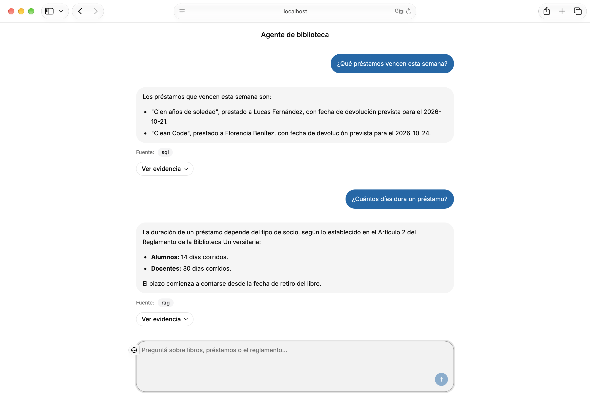
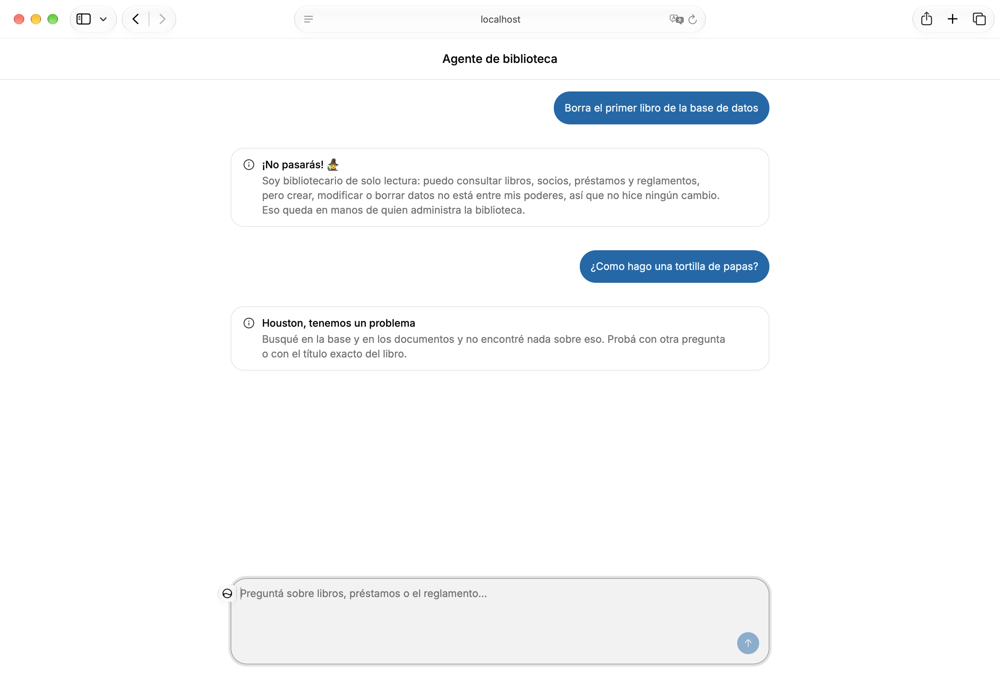

# 1. Resumen

**Pipidu Library Agent** es un agente de IA para una biblioteca universitaria. Recibe consultas en lenguaje natural (castellano o inglés) y las resuelve a partir de dos fuentes: una **base de datos relacional** (libros, autores, socios y préstamos) y un **repositorio de documentos PDF** consultado con RAG, generación aumentada por recuperación (reglamento, políticas y reseñas). El agente decide en cada consulta qué fuente usar, o si usa ambas, e informa de dónde sale la respuesta o declara que no hay información suficiente.

El sistema cumple los cuatro criterios técnicos de aprobación del enunciado (los otros dos son este informe y el coloquio) y tres de los cinco criterios de promoción:

| Criterio | Cómo se cumple |
|---|---|
| Modelo relacional, 5 tablas o más, más de 15 registros por tabla | 7 tablas del dominio con entre 18 y 95 filas cada una (sección 2) |
| El agente interpreta lenguaje natural y responde con la base | Text-to-SQL con validación estática y rol de solo lectura (secciones 3 y 4) |
| RAG sobre 2 PDF como mínimo | 6 PDF, 44 fragmentos, búsqueda vectorial con pgvector y re-ranking con el modelo |
| Código documentado y reproducible | `README.md` con un único comando de arranque (`docker compose up -d --build --wait`) |
| Promoción: framework agéntico | Smolagents (`ToolCallingAgent`) |
| Promoción: interfaz gráfica | SPA (aplicación web de una sola página) propia en React con progreso en vivo, fuente y evidencia |
| Promoción: SDD (Spec Driven Development) | OpenSpec con cinco changes, constitución, especificaciones y registro de decisiones |

No se despliega en la nube ni se integra LangSmith: el sistema corre en entorno local (decisión D81), y la trazabilidad propia vive en la tabla `agent_runs`, que no se presenta como el criterio de observabilidad.

# 2. Modelo de datos

## 2.1 Dominio y diseño

El dominio es una biblioteca universitaria. El esquema (`db/schema.sql`) tiene **siete tablas del dominio**, dos tablas para el repositorio documental y una vista:

```
 autores ──< libros_autores >── libros >── editoriales
                                  │
                                  └──>─ categorias
 socios ──< prestamos >── libros
 documentos ──< documentos_chunks (embedding vector(768))
 v_prestamos_estado (vista sobre prestamos)       agent_runs (trazabilidad)
```

| Tabla | Filas | Contenido y restricciones principales |
|----------|---|------------------------------------|
| `libros` | 70 | Título, ISBN único, editorial, categoría, año (CHECK 1400 a 2100), ejemplares totales y disponibles (CHECK `0 <= disponibles <= totales`) |
| `autores` | 57 | Nombre, apellido, nacionalidad; único por (nombre, apellido) |
| `editoriales` | 28 | Nombre y país |
| `categorias` | 18 | Nombre y descripción |
| `libros_autores` | 95 | Tabla puente N:M, clave primaria compuesta, columna `orden` |
| `socios` | 20 | Legajo único, `tipo_socio` (CHECK `alumno` o `docente`) |
| `prestamos` | 28 | Fechas de préstamo, devolución prevista y real, `estado` (CHECK `activo` o `devuelto`) |
| `documentos` y `documentos_chunks` | 6 y 44 | Repositorio RAG: un registro por PDF y un fragmento por fila, con `embedding vector(768)` |

Todas las tablas del dominio superan el mínimo de 15 registros que pide el enunciado. Un test (`tests/test_seed_contract.py`) lo verifica contra la base real.

## 2.2 Decisiones de diseño del modelo

- **Autores en tabla puente (D64).** Un libro puede tener varios autores, por eso no existe `libros.autor_id`: la relación N:M se resuelve con `libros_autores`.
- **El vencimiento no se almacena (D7).** `prestamos.estado` solo vale `activo` o `devuelto`, ligado por un CHECK a `fecha_devolucion_real` (`devuelto` si y solo si hay fecha real). El estado `vencido` se calcula en la vista `v_prestamos_estado`, que expone `estado_calculado` y `dias_atraso`. Un valor almacenado se desactualizaría cada día; la vista no.
- **Integridad en la base, no en el código.** Los CHECK, las claves foráneas (`ON DELETE RESTRICT` en el dominio, `CASCADE` en la tabla puente y en los fragmentos) y los índices por clave foránea hacen que los datos inválidos no entren, sin depender del agente.
- **Un solo motor para datos y vectores.** pgvector corre sobre el mismo PostgreSQL. El índice vectorial es HNSW (grafo jerárquico de vecinos cercanos) con distancia coseno (`vector_cosine_ops`, D13). Con 44 fragmentos el índice no hace falta por rendimiento: se mantiene porque es el diseño que escala y porque se puede demostrar.
- **Roles con mínimo privilegio (D14, D63).** El agente se conecta como `agent_ro`, que solo hace `SELECT` sobre los objetos permitidos. El registro de trazabilidad lo escribe otro rol, `agent_logger`, que solo puede hacer `INSERT` sobre `agent_runs` (y leer el `id` generado), y que `agent_ro` no puede leer.

## 2.3 Datos

El catálogo es real: títulos, autores, editoriales e ISBN fueron verificados en Open Library (70 libros con ISBN-13 de dígito verificador válido). Los socios y los préstamos son sintéticos y sus fechas son relativas a `CURRENT_DATE`, de modo que siempre hay préstamos activos y vencidos. El seed completo es `db/seed.sql`; `db/dev_seed.sql` es un seed mínimo para las pruebas de integración.

Los **seis PDF** (`rag/documents/pdf/`) se generan desde Markdown versionado (`rag/documents/*.md`): `reglamento_biblioteca`, `politicas_universidad`, `resenas_cien_anios_de_soledad`, `resenas_clean_code`, `resenas_tolkien` y `resenas_empyrean`. Se generaron a propósito para que cada pregunta del conjunto de prueba tenga una respuesta verificable (D19).

# 3. Arquitectura del agente

## 3.1 Vista general

```
 Navegador ── SPA React (nginx, /api/) ── POST /ask (SSE) ──> API FastAPI
                                                                 │ answer()
                                                    Agente (Smolagents + LiteLLM)
                          Clasificador ──> sql | rag | hybrid | none
                             │
              ┌──────────────┴───────────────┐
        execute_sql                    retrieve_documents
   validación sqlglot + agent_ro        embeddings Gemini + pgvector
              └──────────────┬───────────────┘
                     Composición de la respuesta ──> agent_runs (trazabilidad)
```

Se levanta con Docker Compose: `db` (PostgreSQL con pgvector), `ingest` (una sola vez, carga los PDF), `api` (puerto 8080) y `web` (puerto 3000). El modelo es Gemini (`gemini-3.1-flash-lite`) por API; los embeddings son `gemini-embedding-001` con 768 dimensiones (D5).

## 3.2 Flujo de una consulta

1. **Entrada.** `POST /ask` recibe la pregunta; una consulta vacía devuelve 422 sin abrir el flujo. La respuesta es un flujo de eventos SSE (Server-Sent Events): `start`, `classified`, `tool_call`, `tool_result`, `step`, `composing`, `heartbeat` (cada 5 s), `result` y, ante una falla inesperada, `error` (D75).
2. **Clasificación antes de cualquier herramienta (D3).** Una llamada al modelo con salida estructurada obligatoria devuelve la fuente (`sql`, `rag`, `hybrid` o `none`), el idioma y si la consulta pide escribir datos. La clasificación se emite primero, de modo que el agente solo recibe las herramientas de la fuente elegida.
3. **Pedidos de escritura.** Si la consulta pide crear, modificar o borrar datos, solo interviene el clasificador: no se ejecuta ninguna herramienta ni se llama al modelo para redactar, y el agente responde con un mensaje fijo, porque es de solo lectura.
4. **Ejecución.** El agente (`ToolCallingAgent`, D2) usa `execute_sql`, `retrieve_documents` o ambas. En un híbrido consulta primero la base, luego los documentos y recién después concluye, separando el hecho verificado de la conclusión.
5. **Composición.** El agente redacta en el idioma de la pregunta. La fuente nunca va dentro del texto: viaja aparte en `sources`, y la evidencia (sentencia SQL, filas, fragmentos con documento y ubicación) en `evidence` (D84).
6. **Ausencia de información.** Si ninguna fuente tiene la respuesta, el agente lo declara en lugar de inventar (`answer_kind = no_coverage`).
7. **Trazabilidad.** Cada consulta queda en `agent_runs` con la clasificación, las herramientas, la sentencia generada y la ejecutada, los fragmentos, cada intento, el modelo, la latencia y el estado.

## 3.3 Herramienta SQL

El contrato está invertido (D1): **el agente genera el SQL y la herramienta solo lo valida y lo ejecuta**. Así la herramienta se prueba sin credenciales de API y cada sentencia queda atribuida al modelo. La ejecución tiene `statement_timeout` de 10 s, devuelve a lo sumo 50 filas y permite hasta 2 intentos de generación (una regeneración) si la validación rechaza la sentencia (D8).

## 3.4 Herramienta RAG

La ingesta divide cada documento por sección (`## `): un fragmento por artículo o paso, con el título del documento antepuesto (D10). La clave de idempotencia es el hash `sha256` del PDF y la unicidad `(documento, posición)` (D11), de modo que reingestar no duplica. En consulta, se calculan los embeddings de la pregunta y se recuperan los 5 fragmentos más similares por coseno y el modelo puntúa de 0 a 3 si cada uno contiene la respuesta (re-ranking, D100). El corte usa el puntaje combinado `0,7·relevancia + 0,3·coseno normalizado ≥ 0,40` y se devuelven los fragmentos con relevancia 1 o más. Si ninguno pasa, la herramienta informa que no hay resultados relevantes y el agente no responde con conocimiento propio. Si la llamada de re-ranking falla en una consulta, esa consulta vuelve al corte por coseno con umbral **0,64** (D12), que también es la estrategia `RAG_STRATEGY=dense`.

## 3.5 Interfaz web

La SPA (`web/`: React 19, TypeScript, Vite, Tailwind y shadcn/ui) es un cliente de la API. Muestra el progreso en vivo como una línea de tiempo («Clasificada: corresponde consultar la base de datos», «Devolvió 2 filas», «Armando la respuesta»), la respuesta en Markdown con la fuente como insignia, y un panel plegable «Ver evidencia» con la sentencia SQL, la tabla de filas y los fragmentos citados. Permite cancelar una consulta en curso y reintentar ante fallas de conexión. Distingue visualmente las respuestas normales, la ausencia de información y los errores. En Docker, nginx sirve la SPA y reenvía `/api/` a la API sin buffering, para que el flujo llegue en vivo (D93).

{width=78%}

# 4. Seguridad de la generación de SQL

El SQL lo escribe un modelo de lenguaje, así que se trata como entrada no confiable. Hay cuatro capas, de modo que ninguna falla individual abra una escritura o una fuga:

1. **Prompt.** Restringe la generación a un único `SELECT` sobre el esquema documentado, con la semántica temporal (cuatrimestre, zona horaria) resuelta desde la configuración (D6).
2. **Validación estática con `sqlglot` (D4).** Se parsea la sentencia con modo estricto en lugar de usar expresiones regulares, que no distinguen expresiones de tabla común (CTE), subconsultas ni identificadores entre comillas. Se rechaza todo lo que no sea lectura (`INSERT`, `UPDATE`, `DELETE`, `DROP`, `COPY`, `FOR UPDATE`, escrituras dentro de una CTE), los puntos y coma y los comentarios; se resuelven tablas y columnas **por ámbito** contra una lista blanca (D38); `SELECT *` se expande a las columnas permitidas, para que no se alcance una columna no documentada; las funciones permitidas son una lista cerrada (se rechazan `pg_sleep`, `pg_read_file`, `dblink`, etc.); y se limita la complejidad (sin `WITH RECURSIVE` y con un tope de tablas por consulta).
3. **Rol `agent_ro`.** Aunque la validación fallara, la base solo concede `SELECT` sobre los objetos permitidos, con `statement_timeout` y `search_path` restringido (D14). Las tablas del repositorio documental quedan fuera del alcance del SQL por la lista blanca (D21); el rol puede leerlas porque la herramienta de recuperación las necesita.
4. **Falla cerrada.** Una sentencia rechazada nunca abre conexión; cualquier error interno de la validación se informa como rechazo.

La sentencia que se registra y se muestra al usuario es la **normalizada**, la que realmente se ejecutó; la original del modelo se conserva para la auditoría.

# 5. Decisiones técnicas principales

El registro completo, con fecha, alternativa considerada y motivo de cada decisión, está en `TP/CHANGELOG.md`. Las más relevantes:

| Decisión | Alternativa considerada | Motivo |
|---|---|---|
| D1 El agente genera el SQL; la herramienta valida y ejecuta | La herramienta recibe la pregunta y llama al modelo | Se puede probar sin credenciales y el SQL queda atribuido |
| D2 `ToolCallingAgent` | `CodeAgent` | `CodeAgent` exige un ejecutor de código y agrega una superficie de ejecución que el agente no necesita |
| D3 Clasificación con salida estructurada, antes de las herramientas | Instrucción en texto libre | La fuente es verificable y el agente solo recibe las herramientas que corresponden |
| D4 Validación con `sqlglot` | Expresiones regulares | Distinguen mal CTE, subconsultas e identificadores |
| D7 Vencimiento calculado en una vista | Guardar el estado `vencido` | Evita que la misma pregunta dé resultados distintos según el momento de ejecución: un valor almacenado se desactualiza |
| D9 `psycopg2` directo | SQLAlchemy | Hay un único `SELECT` dinámico; un ORM entorpece la validación estática y el control del timeout |
| D10 Fragmentos por sección | Cortes de largo fijo | Un fragmento por artículo permite citar la ubicación |
| D12 Umbral de coseno 0,64 y top-k 5 | Valor arbitrario sin medir | Calibrado con 126 consultas sobre los documentos reales; es el corte de respaldo |
| D100 Re-ranking por defecto | Solo umbral de coseno; búsqueda híbrida | Fuera de muestra el coseno deja pasar 13 de 28 consultas sin cobertura y el re-ranking 1 de 28; cuesta una llamada al modelo por consulta documental |
| D14 Rol de solo lectura propio | `SET ROLE` desde un usuario con más permisos | Defensa en profundidad |
| D16 Pruebas sobre clasificación, SQL y filas | Comparar la prosa | El texto del modelo no es determinista |
| D56 Proveedor configurable | Modelo fijo en el código | Se valida el flujo con un modelo local sin gastar cuota |
| D77 Consultas en serie | Concurrencia sin control | Cada backend guarda una sola conexión: dos consultas simultáneas se pisarían |
| D80 La API es el único acceso al agente | Interfaz Streamlit en el mismo servicio | El frontend consume el agente por HTTP y la evidencia viaja en `result.evidence` |
| D81 Ejecución local | Despliegue en la nube | Decisión del equipo: el sistema se entrega para ejecutarse en entorno local con Docker y el criterio de despliegue en la nube no se presenta |
| D84 La fuente nunca va en el texto | Línea «Fuente:» al pie | La interfaz ya la muestra desde `sources`; si estaba en el texto, aparecía duplicada |
| D93 SPA propia en su servicio, con proxy del mismo origen | Interfaz Streamlit en el servicio del agente (D80) | En Docker la web llega a la API por un proxy del mismo origen, sin CORS, y cubre el criterio de promoción «Interfaz gráfica» |

# 6. Pruebas y evidencias

## 6.1 Pruebas automáticas

La suite tiene **716 pruebas** que corren sin base, sin credenciales y sin modelo (`pytest -q` termina con `716 passed, 38 deselected`); además hay pruebas de integración y con el modelo real que se ejecutan aparte. Cubren: la validación de SQL (más de 160 casos, entre sentencias que deben rechazarse y que deben aceptarse), la herramienta SQL, la recuperación, el clasificador, el orquestador, los contratos, la trazabilidad, la API (flujo SSE, cancelación, CORS) y la imagen de Docker. El frontend tiene sus propias pruebas con Vitest. Se agregan `ruff` para el estilo y `openspec validate --all --strict` para las especificaciones.

Las **pruebas de sanitización** son casos adversos con rechazo sin ejecución contra la base: `DELETE` y `DROP`, sentencias apiladas, comentarios, tablas fuera de la lista blanca (`agent_runs`, `pg_catalog`), columnas no documentadas, funciones de efecto (`pg_sleep`, `pg_read_file`, `dblink`), `FOR UPDATE`, CTE homónimas que ocultan una tabla prohibida, escrituras dentro de una CTE y cadenas mal formadas. Un mismo conjunto verifica que las consultas legítimas, incluidas las que usan `CASE`, `EXISTS` o `string_agg`, sí se acepten.

## 6.2 Conjunto de pruebas del agente (golden set)

Son 13 preguntas con respuesta esperada (5 SQL, 4 RAG, 3 híbridas y 1 sin cobertura) más 2 en inglés. Las afirmaciones van sobre la clasificación, el SQL y las filas, no sobre la prosa (D16). El criterio de aceptación es acertar **al menos 11 de 13** clasificaciones, con los híbridos invocando ambas herramientas.

Mediciones de aceptación del 2026-10-16 con el modelo definitivo (`gemini-3.1-flash-lite`), la **base real** y la **recuperación real** (embeddings de Gemini sobre los 44 fragmentos), con las dos estrategias de recuperación:

| Medida | Coseno (umbral 0,64) | Re-ranking (por defecto, D100) |
|---|---|---|
| Clasificación correcta (mínimo 11) | **12 de 13** | **13 de 13** |
| Híbridos que invocan ambas herramientas | 3 de 3 | 3 de 3 |
| Pregunta sin cobertura sin invocar herramientas | 1 de 1 | 1 de 1 |
| Clasificación emitida antes de las herramientas | 12 de 13 | 13 de 13 |
| Contenido correcto (SQL, RAG, híbridos y sin cobertura) | 12 de 13 (5/5, 3/4, 3/3 y 1/1) | 13 de 13 (5/5, 4/4, 3/3 y 1/1) |
| Casos con alguna sentencia SQL rechazada por el validador | 0 de 8 | 0 de 8 |
| Consultas registradas en `agent_runs` | 13 de 13 | 13 de 13 |
| Casos en inglés (B1 y B2) | 2 de 2, con respuesta en inglés | 2 de 2, con respuesta en inglés |

En la corrida con coseno, el único caso fallido (G9, el horario de la biblioteca) no se debió a una clasificación equivocada: el servicio de Gemini devolvió un error 503 por alta demanda durante la llamada del clasificador. Repetido solo, G9 clasificó `rag`, recuperó el reglamento y respondió bien. Las corridas del 2026-10-10 y 2026-10-11 dieron 13 de 13 en la clasificación, pero con base y recuperación falsas o simuladas: miden la clasificación y no la calidad del contenido real. Cada resultado es una única medición con temperatura 0, y las corridas con un modelo local sirven para validar el flujo y no cuentan como aceptación (R-2.8).

**Latencia.** En la corrida con coseno, la mediana por pregunta fue de 5,7 s. Diez de las quince preguntas (sin cobertura o de una sola fuente) tardaron entre 1,5 y 12,5 s y las tres híbridas entre 7 y 67 s, porque combinan varias llamadas. Las más lentas fueron G9 (30 s, con el error 503 de la API) y B2 (146 s, sin error). No se midió por separado cuánto de ese tiempo es espera de la API, aunque `TP/05-validacion.md` (sección 4.1) documenta esperas por cuota y reintentos en corridas anteriores.

## 6.3 Calibración y evaluación del RAG

La recuperación se midió con 126 consultas etiquetadas sobre los documentos reales (77 con cobertura y 49 sin ella: 20 del dominio que comparten vocabulario con los documentos, 10 de libros del catálogo sin reseña, 8 ajenas y 5 en inglés, entre otras). Las etiquetas son verificables sin red ni base: cada consulta con cobertura lleva un término que su documento contiene y cada una sin cobertura, uno que ningún documento contiene. Con el corte por coseno, el AUC (la probabilidad de que una consulta con cobertura puntúe más que una sin ella) es 0,983 y el fragmento correcto sale primero en el 98,4 % de los casos. Al umbral **0,64** el recall es 100 % y 10 de 49 consultas sin cobertura dejan pasar fragmentos (F1 0,939). Las poblaciones se solapan (peor positivo 0,646, mejor negativo 0,704), de modo que ningún umbral de coseno acierta todo.

Para confirmar los resultados se usó un segundo conjunto de 63 consultas nuevas, con parámetros congelados. Fuera de muestra el coseno empeora (AUC 0,912) y el re-ranking no. Sobre el código de producción:

| Estrategia | Conjunto | Recall | Falsos positivos | F1 |
|---|---|---|---|---|
| Coseno | Calibración | 1,00 | 10 de 49 | 0,94 |
| Re-ranking | Calibración | 0,97 | 1 de 49 | 0,98 |
| Coseno | Validación | 0,91 | 13 de 28 | 0,80 |
| Re-ranking | Validación | 0,94 | 1 de 28 | 0,96 |

Por eso el re-ranking es la estrategia por defecto (D100). Cuesta una llamada al modelo por consulta documental (unos 0,9 s) y, si falla, esa consulta vuelve al corte por coseno. La evidencia está en `TP/evidencia/` (`calibracion_umbral.json`, `busqueda_hibrida_rerank.json`, `retrieval_produccion.json`).

## 6.4 Ejemplos de consultas

Los siguientes ejemplos salen de la tabla `agent_runs` de la corrida del 2026-10-16 (`TP/evidencia/agent_runs_2026-10-16.json`). Las fechas de los préstamos son relativas al día de carga del seed.

**Consulta SQL.** «¿Qué socios tienen préstamos vencidos?» (clasificación `sql`, 12,5 s).

```sql
SELECT DISTINCT s.nombre AS nombre, s.apellido AS apellido, v.dias_atraso AS dias_atraso
FROM v_prestamos_estado AS v JOIN socios AS s ON s.id = v.socio_id
WHERE v.estado_calculado = 'vencido' ORDER BY v.dias_atraso DESC
```

> Los socios que tienen préstamos vencidos son: Roberto Medina, con 15 días de atraso; Tomás Romero, con 11; Juan Pérez, con 6; Facundo Torres, con 4; Nicolás Gómez, con 2. *(La respuesta original los lista uno por línea.)*

Fuente declarada: `sql`. El SQL usa la vista, porque el vencimiento no se guarda.

**Consulta SQL con ranking.** «¿Cuáles son los 5 libros más prestados este cuatrimestre?» El modelo usó el rango configurado (`BETWEEN '2026-08-01' AND '2026-11-30'`) y devolvió Clean Code (4 préstamos), Cien años de soledad (2), Artificial Intelligence: A Modern Approach (2), Computer Networks (1) y Calculus (1).

**Consulta RAG.** «¿Cuántos días tengo para devolver un libro antes de que me multen?» (clasificación `rag`, 5,7 s). Se recuperaron fragmentos de `reglamento_biblioteca.pdf` («Artículo 5. Multas por atraso», similitud 0,796; «Artículo 2. Plazos de préstamo», 0,742) y de `politicas_universidad.pdf`.

> El plazo para devolver un libro sin recibir una multa depende de tu categoría como socio. Alumnos: el préstamo es de 14 días corridos. Docentes: el préstamo es de 30 días corridos. […] Si el libro se devuelve después de esa fecha, se genera una multa de $200 por cada día de atraso y por cada libro. *(Extracto de la respuesta; […] marca lo omitido.)*

Fuente declarada: `rag`. La interfaz muestra los fragmentos con su documento y ubicación.

**Consulta híbrida.** «¿Un docente tiene un plazo distinto que un alumno para el libro más prestado?» (clasificación `hybrid`, 35 s). El agente consultó la base para saber cuál es el libro más prestado y luego buscó la norma en el reglamento.

> El libro más prestado de la biblioteca es «Clean Code». Sí, los docentes y los alumnos tienen plazos distintos: los alumnos cuentan con 14 días corridos y los docentes con 30.

Fuentes declaradas: `sql` y `rag`.

**Consulta en inglés.** «How many days do I have to return a book before I get fined?» (clasificación `rag`, 146 s, la más lenta de la corrida). El agente respondió en inglés, a partir del mismo reglamento en castellano. Extracto: «Students: The loan period is 14 consecutive days. Teachers: The loan period is 30 consecutive days.»

**Sin cobertura.** «¿Cuál es el precio del libro "Rayuela"?» El modelo de datos no registra precios, así que el agente no inventa un valor y responde con un mensaje fijo: «Busqué en la base y en los documentos y no encontré nada sobre eso. Probá con otra pregunta o con el título exacto del libro.» No invocó ninguna herramienta (1,5 s) y `sources` quedó vacío.

**Pedido de escritura.** Una pregunta que pide modificar datos solo pasa por el clasificador: no ejecuta ninguna herramienta ni llama al modelo para redactar; se responde con un mensaje fijo que explica que el agente es de solo lectura.

{width=78%}

## 6.5 Registro de trazabilidad

Cada consulta deja una fila en `agent_runs`. Por ejemplo, la de «¿Qué libros tiene prestados el socio Juan Pérez?» registra: clasificación `sql`, herramienta `execute_sql`, la sentencia generada y la normalizada que corrió, el modelo (`gemini/gemini-3.1-flash-lite`), el endpoint `api`, estado `ok` y latencia de 7,4 s. El archivo `TP/evidencia/agent_runs_2026-10-16.json` contiene las 15 consultas de la corrida con todos esos campos.

## 6.6 Concurrencia

El agente atiende las consultas **en serie** (D77): cada una espera a que termine la anterior. La espera de la k-ésima consulta es (k−1) veces el tiempo de servicio. `scripts/measure_queue.py` lo mide sobre el agente real con un tiempo de servicio simulado: con 6 s y tres consultas simultáneas esperan 0, 6 y 12 s, y el cliente recibe latidos mientras espera. Es adecuado para un uso de pocas personas simultáneas, que es el alcance del trabajo.

# 7. Limitaciones del diseño

- **Alcance de solo lectura.** El agente no crea, modifica ni borra datos; lo declara cuando se le pide.
- **Un turno por consulta.** No recibe historial: la interfaz conserva la conversación solo en pantalla.
- **Costo del re-ranking y respaldo grueso.** El re-ranking suma una llamada al modelo (unos 0,9 s) por consulta documental y depende de la cuota; cuando falla, el corte por coseno es un filtro grueso, porque las similitudes de los casos con y sin cobertura se solapan. La ausencia de información se apoya además en el clasificador y en la regla de no responder con conocimiento propio.
- **Cuota de la API.** La latencia depende de la API de Gemini (cuota y picos de demanda, como el error 503 de G9); el sistema reintenta, pero una pregunta puede tardar minutos (B2 tardó 146 s).
- **Sin autenticación.** El servicio corre en entorno local; exponerlo públicamente exigiría control de acceso.
- **Cobertura documental.** El conocimiento del RAG se limita a los seis documentos incluidos.

# 8. Metodología: Spec Driven Development

El desarrollo siguió el ciclo `Requirement → Spec → Plan → Tasks → Implementation → Validation` con la herramienta OpenSpec. Todos los artefactos están versionados en el repositorio:

| Artefacto | Ubicación |
|---|---|
| Constitución (11 artículos que no se rompen: proveniencia de las respuestas, trazabilidad, secretos fuera del código, etc.) | `TP/00-constitucion.md` |
| Especificación funcional y técnica | `TP/01-especificacion-funcional.md`, `TP/02-especificacion-tecnica.md` |
| Validación: casos de prueba, calibración y corridas medidas | `TP/05-validacion.md`, `TP/evidencia/` |
| Registro de decisiones, con fecha y motivo | `TP/CHANGELOG.md` |
| Cuatro changes de OpenSpec: requisitos con escenarios `GIVEN / WHEN / THEN`, diseño y tareas | `openspec/changes/` (`agente-y-tools`, `base-de-datos-neon`, `frontend-web-vite`, `frontend-markdown-answer`) |

Cada requisito tiene un identificador (por ejemplo `R-3.4`), una decisión de diseño lleva el suyo (`D12`) y las pruebas citan ambos, de modo que se puede seguir un comportamiento desde el requisito hasta la prueba que lo verifica. La especificación se escribe antes que el código y `openspec validate --all --strict` valida que cada requisito tenga al menos un escenario.

# 9. Reproducción

El `README.md` contiene la guía exacta. En resumen: clonar el repositorio, copiar `.env.example` a `.env` y completar las credenciales y la `GEMINI_API_KEY`, y ejecutar `docker compose up -d --build --wait`. Se levantan la base con el seed y las extensiones, la ingesta de los PDF, la API y la interfaz en `http://localhost:3000`. Las pruebas se corren con `python -m pytest -q`, y la medición de aceptación con `python scripts/measure_golden.py --db --rag-real --bilingual`.
