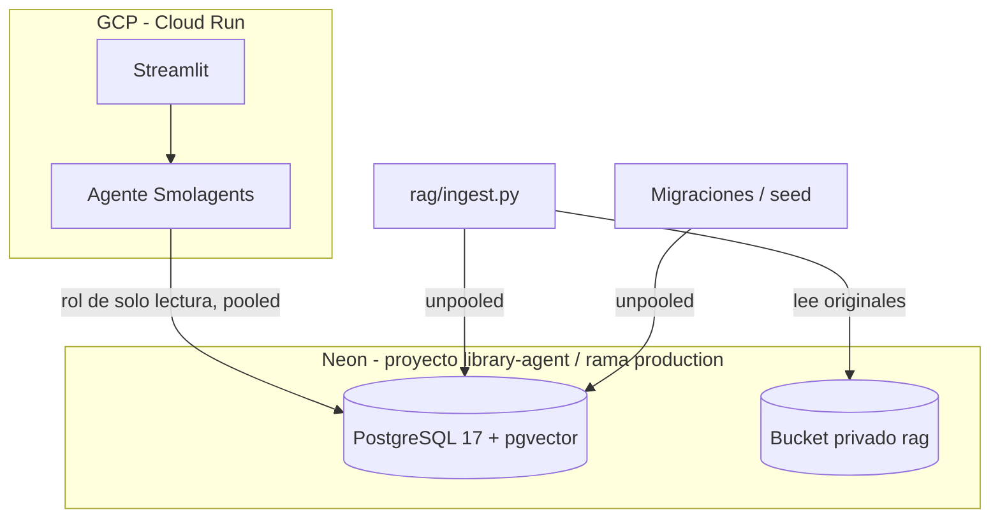

# Design

## Context

El esquema, el seed y los documentos del RAG se diseñaron en el repositorio de la integrante
responsable de base de datos y RAG (D19), antes de integrarse a este. Se definieron **antes de crear
ninguna tabla**, se validaron en ramas descartables de Neon (`test-ddl`, `test-seed`) y recién
entonces se aplicaron a `production`. Ese orden es parte de la justificación: el DDL aprobado es el
que corre, no un borrador.

Condición de contorno: tres integrantes y entrega el 16/10/2026. La base tiene que ser accesible
para todos sin que cada uno administre una instancia.

## Goals / Non-Goals

**Goals:**
- Que el esquema justifique cada decisión que condiciona al agente (text-to-SQL, seguridad, RAG).
- Que los datos y documentos sean reproducibles desde este repo.

**Non-Goals:**
- Reemplazar la base local de Docker (D65): sigue siendo el entorno de desarrollo y de CI.
- Ingesta de embeddings (otro change).

## Arquitectura

| Uso | Conexión | Motivo |
|---|---|---|
| Agente en runtime | pooled | Muchas conexiones cortas |
| DDL, migraciones, seed, ingesta | unpooled | pgbouncer no es apto para DDL |
| SQL tool | rol de solo lectura con URL propia | Defensa en profundidad (R-3.5) |

## Decisions

Las decisiones de este change se numeran `D-DB1…D-DB10` para no colisionar con `D1…D74` de
`TP/CHANGELOG.md`, que es el registro canónico; allí se asientan con alternativa descartada y motivo
(entrada del 2026-10-13).

| ID | Decisión | Alternativa descartada y motivo | Traza |
|---|---|---|---|
| D-DB1 | Neon como base compartida; GCP solo aloja agente + UI | Cloud SQL: más costo y fricción con pgvector; Neon ya trae pgvector, ramas y bucket | R-7.1, T9.6 |
| D-DB2 | `GENERATED ALWAYS AS IDENTITY` | `SERIAL`: no estándar y permite insertar ids a mano | R-7.2 |
| D-DB3 | `libros_autores` N:M | `libros.autor_id`: no representa libros con varios autores (Russell & Norvig). Origen de D64 | R-7.3 |
| D-DB4 | `prestamos.estado` solo `activo`/`devuelto`, con CHECK contra `fecha_devolucion_real` | Guardar `vencido`: se desactualiza con el paso del tiempo | R-7.4 |
| D-DB5 | Vista `v_prestamos_estado` con `estado_calculado` y `dias_atraso` | Que el agente calcule fechas: duplica lógica y es fuente de errores en el SQL generado | R-7.5 |
| D-DB6 | `ejemplares_disponibles` como columna con CHECK `0..totales` | Derivarla de préstamos: complica el SQL que genera el modelo | R-7.6 |
| D-DB7 | `ON DELETE RESTRICT` en dominio, `CASCADE` en puente y chunks | `CASCADE` general: borraría historial de préstamos | R-7.7 |
| D-DB8 | `vector(768)` + HNSW coseno | Más dimensiones: más almacenamiento sin ganancia con ~22 chunks | R-7.8 |
| D-DB9 | El rol del SQL tool no ve `documentos*` (el `rag_tool` lee los chunks con su propio acceso, D63) | Acceso total: el SQL tool no necesita chunks ni embeddings | R-7.9 |
| D-DB10 | Multas, plazos y límites **no** son tablas: viven en el reglamento | Tabla de políticas: la consulta mixta se resolvería solo con SQL y el RAG quedaría sin función | R-9.2, R-8.4 |

### Por qué las reglas de negocio no están en la base (D-DB10)

"Juan Pérez tiene un libro prestado hace 20 días, ¿le corresponde multa?" solo se contesta combinando
SQL (fecha del préstamo y tipo de socio) con RAG (plazo y multa). Si las reglas estuvieran en tablas,
los casos híbridos del golden set no ejercitarían el RAG. Es una decisión de diseño del dominio,
no una omisión.

### Reglas del reglamento (fuente de verdad)

| Regla | Alumno | Docente |
|---|---|---|
| Plazo de préstamo | 14 días | 30 días |
| Máximo de libros simultáneos | 3 | 5 |
| Renovaciones | 1 vez, +7 días | 1 vez, +14 días |
| Multa por atraso | $200 por día | $200 por día |

## Cómo se aplicó (orden y evidencia)

1. DDL revisado y aprobado antes de crear tablas.
2. Validado en la rama `test-ddl` y aplicado a `production`: 9 tablas, 1 vista, pgvector 0.8.6 (la nota original decía 8; el DDL declara 9). En la
   rama se comprobó que los CHECK/UNIQUE rechazan datos inválidos, que `vector(768)` rechaza otras
   dimensiones y que `readonly_role` solo lee tablas de negocio.
3. Seed validado en `test-seed` y aplicado a `production`: autores 33, editoriales 16, categorías 15,
   libros 19, libros_autores 34, socios 20, préstamos 28 (18 devueltos, 5 activos, 5 vencidos).
4. PDFs generados y subidos al bucket `rag` (6 objetos, prefijo `documents/`).

Las ramas de prueba ya fueron eliminadas; la evidencia es el registro de esta sección.

## Risks / Trade-offs

- **Desfase con `db/schema.sql`**: el DDL de Neon no corre tal cual en PostgreSQL; `db/schema.sql` es la
  versión normalizada (D65) y sus cambios están anotados en la cabecera. Quien mantenga el esquema en
  Neon debe reflejarlos, sobre todo `vector_cosine_ops` en el HNSW.
- **El seed envejece**: las fechas son relativas a `CURRENT_DATE` al cargar; los atrasos crecen día a día.
  Los tests no deben aseverar días de atraso literales.
- **Seed no idempotente**: aborta si ya hay datos. Reaplicarlo exige truncar.
- **Rol de solo lectura sin login en Neon** (pendiente, 9.7): existe como `NOLOGIN`; hasta resolverlo el
  agente se mide contra la base local.
- **Reseñas y catálogo**: los 3 libros reseñados deben existir en el catálogo del seed (R-8.3).
